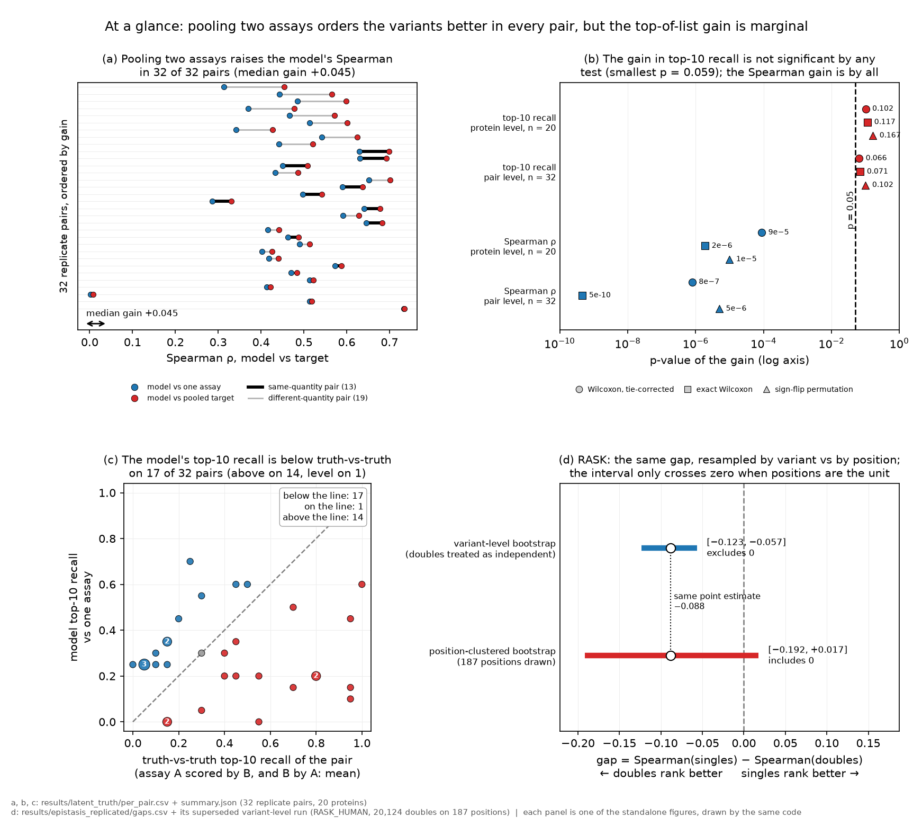
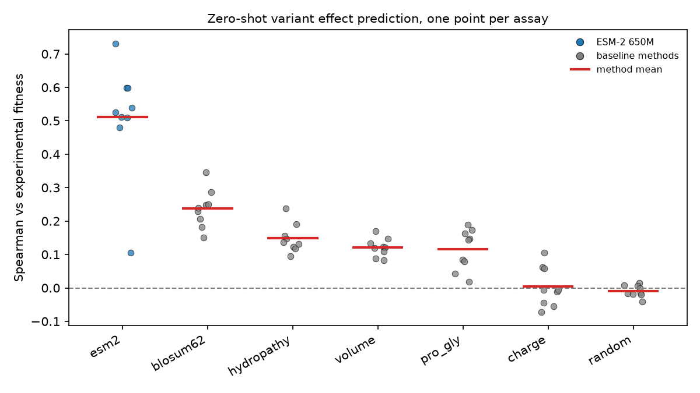
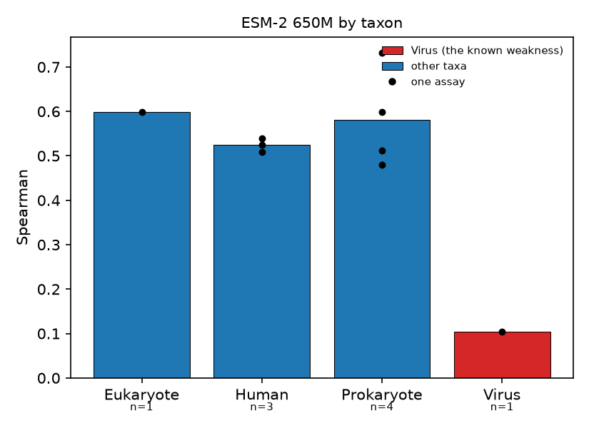
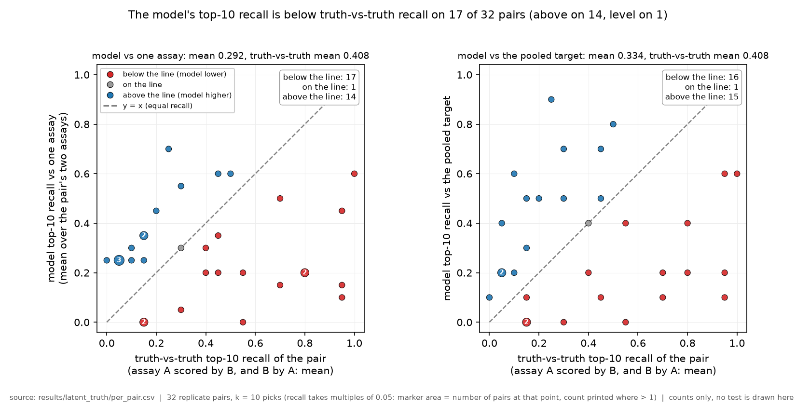

# Zero-shot variant effect prediction with ESM-2

Scoring missense variants with a protein language model that has never seen a
fitness measurement, benchmarked against experimental deep mutational scanning
data from ProteinGym, and checked against the official published numbers.

The question is whether a model trained only to fill in masked residues across
UniRef has learned enough about protein constraint to predict which mutations
break a protein. The answer is a qualified yes, and the qualifications are the
interesting part.

## At a glance



- **(a) A better target ranks better.** Pooling two assays of the same protein
  raises the model's Spearman in 32 of 32 replicate pairs (median +0.045) and in
  20 of 20 proteins (median +0.051).
- **(b) It does not pick the top ten better, not significantly.** Top-10 recall
  gains p = 0.0655 / 0.0710 / 0.102 (pair level) and 0.102 / 0.117 / 0.167
  (protein level, the primary test); none of the six crosses 0.05, nor does any
  of the 18 tests that also cover the same-quantity and reliable-pair subsets
  (smallest p = 0.059). The Spearman gain is p < 0.012 in all 18.
- **(c) The model is not shown to match truth-vs-truth, or to fall short of it.**
  On 17 of 32 pairs its top-10 recall is below the agreement of the pair's two
  assays, on 14 above, on 1 level; the shortfall is not significant (p = 0.146 /
  0.152 / 0.073), so this data cannot separate the model from cross-assay
  agreement.
- **(d) Position clustering decides the RASK sign.** The singles-minus-doubles
  Spearman gap is −0.088 either way, but its interval is [−0.123, −0.057]
  (excludes zero) when the 20,124 doubles are resampled as independent variants
  and [−0.192, +0.017] (includes zero) when the 187 positions are resampled.

Three more things the review changed, each with its own figure below: matching the
fitness range removes most of the singles-versus-multi gap (figure e); HIS7's
"epistatic" residual is larger than the doubles' own total variance, so it is mostly
noise (figure g); and the viral-gap family test is p = 0.0213, not the 0.00047 that
counting checkpoints gave (figure f).

## Does the implementation actually work

A pipeline that is off by one still produces plausible correlations, so the
check is against the reference: ProteinGym publishes per-assay Spearman for ~97
predictors.

| assay | this implementation | ProteinGym published | difference |
|---|---|---|---|
| IF1_ECOLI_Kelsic_2016 | 0.598 | 0.599 | −0.001 |
| CCDB_ECOLI_Tripathi_2016 | 0.511 | 0.511 | 0.000 |
| SUMO1_HUMAN_Weile_2017 | 0.509 | 0.509 | 0.000 |
| RL40A_YEAST_Roscoe_2013 | 0.598 | 0.599 | −0.001 |
| DYR_ECOLI_Thompson_2019 | 0.480 | 0.480 | 0.000 |
| NUD15_HUMAN_Suiter_2020 | 0.526 | 0.526 | 0.000 |
| TPMT_HUMAN_Matreyek_2018 | 0.539 | 0.539 | 0.000 |
| BLAT_ECOLX_Stiffler_2015 | 0.732 | 0.731 | +0.001 |
| R1AB_SARS2_Flynn_2022 | 0.105 | 0.105 | 0.000 |

Mean difference −0.0001, maximum absolute difference 0.0006; the residual is
rounding in the published table.


One real bug had to be fixed on the way: rows were built as
`{"assay": dms_id, **metadata}` and the metadata had its own `assay` key, which silently
replaced the DMS id, so every lookup against the official table missed and the
comparison printed an empty table instead of failing
(`test_metadata_does_not_collide_with_result_columns`).

## What the model is worth against cheap alternatives

A correlation of 0.5 means nothing alone; the comparison that matters is against
methods that need no model. Mean Spearman over the 8 non-viral assays:

| method | mean Spearman | what it knows |
|---|---|---|
| **ESM-2 650M** | **0.562** | sequence context, learned from UniRef |
| BLOSUM62 | 0.242 | how often this swap appears in aligned homologs |
| hydropathy change | 0.152 | Kyte-Doolittle scale only |
| side-chain volume change | 0.123 | size only |
| proline/glycine heuristic | 0.108 | three structural rules of thumb |
| charge change | −0.003 | formal charge at pH 7 |
| random | −0.008 | nothing |



Context is worth roughly twice a position-blind substitution matrix: the part of
the signal that comes from knowing where in this protein the residue sits.
BLOSUM62's 0.242 is not nothing; read any new method at 0.3 against it.

## The caveat that matters for actually using it

Spearman is computed over the whole assay, mostly variants that are obviously
fine or obviously dead. For choosing a handful of variants to build, the
question is how many of the model's top picks are genuinely good. Top-10 recall
(the fraction of the model's 10 highest-ranked variants that are truly in the
assay's top 10%) across the nine assays: 0.0, 0.1, 0.1, 0.2, 0.2, 0.2, 0.2, 0.6,
0.9; random scores 0.1. On five of nine the top 10 picks are no better than
random despite a respectable Spearman: the model separates dead variants from
live ones and ranks poorly within the live ones, which is the regime an
engineering campaign cares about. The sections below ask why.

## Where it fails, and why that is predictable



The SARS-CoV-2 assay scores 0.105 against 0.56 for everything else, and BLOSUM62
beats ESM-2 on it (0.207 vs 0.105). Not a bad draw: ESM-2's published average on
viral proteins across the benchmark is 0.261 against 0.457 on human proteins. The
model learns constraint from conservation across UniRef, which assumes residues
are conserved because the protein needs them; viral proteins are also under
immune selection, so positions vary across strains for reasons unrelated to
folding, and the model reads that variation as tolerance. For viral targets use a
method built on an alignment of the specific family.

## The mutational landscape


Predicted effect of all 20 amino acids at every position of E. coli IF1, above
the measured fitness from the same assay. The model has seen no experimental
data; the vertical dark stripes are positions that tolerate nothing, and they
line up with the measured ones at Spearman 0.598.

## The full benchmark, and the aggregation nobody mentions

The nine-assay subset is eight small single-mutant assays plus one viral
failure; its mean Spearman (0.562) is not comparable to any published number. All
217 assays:

<!-- BEGIN GENERATED: full_benchmark -->
|  | this implementation | ProteinGym published | difference |
|---|---|---|---|
| headline (macro over 5 categories) | +0.415 | +0.414 | +0.001 |
| per-assay mean (unbalanced) | +0.439 | +0.438 | +0.001 |
<!-- END GENERATED: full_benchmark -->

<!-- BEGIN GENERATED: full_benchmark_coverage -->
217 of 217 assays scored. Against the published per-assay column: mean difference +0.0009, median absolute 0.0003, maximum absolute 0.2307. 214 of 217 assays within 0.01.
<!-- END GENERATED: full_benchmark_coverage -->

The headline is not the mean of the per-assay values: ProteinGym's 0.414 for
ESM-2 650M sits 0.024 *below* the plain mean of its own per-assay column. The
two-stage rule (average per UniProt id within a group, then the five functional
categories with equal weight; derivation in the `run_full_benchmark.py` docstring)
reproduces all twelve published subgroup columns to within 0.0005 and every
published headline from 8M to 15B (`tests/test_aggregate.py`). The published numbers
are over **all** mutants, not single substitutions: on A4_HUMAN_Seuma_2022 scoring
everything gives 0.431 against a published 0.431, singles only 0.498, which would
have put 20 of the 217 assays off by up to 0.10.

## Why the viral failure happens, tested rather than asserted

The immune-selection explanation predicts that a method reading conservation off
an alignment *of that viral family* should do well on the same assays, because
immune-driven variation is sparse within a family even when common between them.
I implemented the site-independent model (Hopf et al. 2017: per-column amino acid
frequencies from the assay's own MSA, scored as
`log f(mut|position) − log f(wt|position)`), the weakest thing that qualifies as
alignment-based, so a conservative test.

<!-- BEGIN GENERATED: viral_comparison -->
| group | assays | alignment (ours) | alignment (published) | ESM-2 650M (published) | alignment beats ESM-2 |
|---|---|---|---|---|---|
| animal viruses | 24 | +0.408 | +0.398 | +0.168 | 21/24 |
| bacteriophages | 7 | +0.328 | +0.268 | +0.615 | 1/7 |
| all viral assays | 31 | +0.390 | +0.369 | +0.269 | 22/31 |
<!-- END GENERATED: viral_comparison -->

Over all 31 viral assays the two methods are close, and that average hides
opposite effects: the alignment wins 21 of 24 animal-virus assays and loses 6 of
7 bacteriophage assays. That is what the immune-selection story predicts, and the
phage row is what makes it a test rather than a fit: a phage replicates in a
bacterium, which has no adaptive immune system, so there is no immune selection
to confuse a model, and the language model wins there, as it should.

Two implementation traps produced plausible numbers while wrong (the `.a2m` query
row is a subsequence of the target on 20 of the 31 viral assays, and aligning it first
took the viral mean from 0.16 to 0.39; the first N rows of a score-sorted alignment are
one clade, not a sample); both are in the `run_viral_alignment.py` docstring. Even then
the method underperforms on the smallest proteins (alignments of 40-60 residues):
VG08_BPP22 and VRPI_BPT7 both go the wrong way.

## The 3B question: a trade, not a regression

Published headline: 0.414 at 650M, 0.406 at 3B, 0.400 at 15B. The 3B checkpoint
(~12 GB) was not downloaded, so local measurements stop at 650M; local and
published numbers are kept apart.

**Local, nine assays, four checkpoints** (`scripts/run_scaling_curve.py`):

<!-- BEGIN GENERATED: scaling_local -->
| model | assays | mean Spearman | sd |
|---|---|---|---|
| 8M | 9 | 0.179 | 0.147 |
| 35M | 9 | 0.348 | 0.213 |
| 150M | 9 | 0.474 | 0.161 |
| 650M | 9 | 0.511 | 0.170 |
<!-- END GENERATED: scaling_local -->

Each step is real (paired differences significant at every step) but the third
buys a quarter of what the first did: by 650M the curve is near its plateau.

**Published.**

<!-- BEGIN GENERATED: scaling_headline -->
| model | params | headline | published_se |
|---|---|---|---|
| ESM2 (8M) | 8M | 0.226 | 0.015 |
| ESM2 (35M) | 35M | 0.321 | 0.015 |
| ESM2 (150M) | 150M | 0.387 | 0.013 |
| ESM2 (650M) | 650M | 0.414 | 0.012 |
| ESM2 (3B) | 3B | 0.406 | 0.011 |
| ESM2 (15B) | 15B | 0.400 | 0.010 |
<!-- END GENERATED: scaling_headline -->

The 0.008 gap sits inside the published bootstrap standard errors (~0.012), so an
unpaired reading cannot call it real; a *paired* test over the 217 assays can,
because it removes between-assay difficulty, which dominates those SEs: 3B − 650M is
−0.0061 (Wilcoxon p = 0.0223, 96 wins against 118 losses) and 15B − 650M −0.0130
(p = 0.0198), against +0.0377 for 650M − 150M (p < 0.0001); the full table is in
[RESULTS.md](RESULTS.md#esm-2-scaling-published). 3B is slightly but consistently
worse on the average assay, and not uniformly:


*Figure h. Change in mean Spearman from 650M to 3B (blue) and to 15B (red) by what
the assay measures (published ProteinGym subgroup columns). Stability, binding,
activity, expression and human-protein assays get worse; viral (+0.033 at 3B,
+0.072 at 15B), organismal-fitness and medium-MSA-depth assays get better.*

The split is by what each assay measures: an objective mismatch, not a scaling
failure (reasoning in the `analyse_esm2_scaling.py` docstring). 650M is the right default
for stability and binding work; for a virus neither 650M nor 3B is the right tool, the
alignment method is.

## The top-k problem is not about burial

Why are the model's top 10 picks no better than random on five of nine assays?
The natural suspicion is burial: nearly any substitution at a buried residue is
damaging, so ranking among those variants is compressed, while an exposed residue
spans a wider range. ProteinGym distributes AlphaFold2 models for all 217 assays,
so it is testable: `src/variant_effect/structure.py` computes per-residue relative
solvent accessibility (all-atom Shrake-Rupley against Tien et al. theoretical
maxima) and `scripts/run_structure_analysis.py` splits each assay's variants into
buried, intermediate and exposed. **The hypothesis is wrong, and in the opposite
direction.**

<!-- BEGIN GENERATED: structure_burial -->
| buried/exposed | n | Spearman | top-10 recall |
|---|---|---|---|
| buried | 3605 | +0.417 | +0.800 |
| intermediate | 3235 | +0.317 | +0.300 |
| exposed | 4167 | +0.282 | +0.100 |
<!-- END GENERATED: structure_burial -->

Spearman is *highest* at buried positions and lowest at exposed ones, and
BLOSUM62 shows the same ordering, so it is a property of the assays, not the
model: a compressed fitness range does not degrade a rank correlation computed
within that range, and at buried positions almost every substitution is damaging,
so calling them all bad is mostly right. The model's top-10 picks are *not*
biased toward exposed positions (mean relative accessibility of the top picks is
within 0.011 of the assay mean, no significant departure from zero), so there is
no shortcut to correct. The constructive test (penalise buried substitutions, fit
on half the assays, evaluate on the other half) was not completed: the held-out
set is too small in the runs that finished to call it either way, so no number
is quoted here and there is no artefact for it.

The candidates left: measurement noise, a better target, and epistasis (next).

## What replicate assays say: 0.350 is agreement, not a ceiling

`scripts/run_topk_analysis.py` uses the 37 pairs of same-protein assays in ProteinGym
(22 proteins with two or more assays, restricted to the variants each pair shares,
at least 200 of them) as replicate measurements; the full table is in
[RESULTS.md](RESULTS.md#replicate-assay-agreement-and-decile-shape). The median
top-10 recall of one assay against its replicate is 0.350, the median Spearman
over the whole shared set 0.610, the median Jaccard overlap of the two top deciles
0.161, and the model's own mean top-10 recall 0.323 over 217 assays and 0.326 over
the 46 assays that have a replicate.

**What 0.350 is, and what it is not.** It is how well one assay agrees with
another on which variants are in the top 10%. It is *not* an information-theoretic
upper bound, and the earlier version of this paragraph was wrong to call it a
ceiling: two assays of one protein are two *noisy* measurements of the same latent
quantity, their agreement is attenuated by both errors, and a predictor that
tracked the latent quantity closely could beat their mutual agreement without
contradicting anything. Two further problems with the original sentence are fixed
here. 0.350 was a median over 37 replicate pairs and 0.323 a mean over a different
population, 217 assays; those are not comparable, hence the 0.326 over the 46
assays that have a replicate. And the honest question is not "is the model near
0.35" but "does the model's recall rise when the target gets closer to the
truth". Inside one assay's top decile the measurement error (median 0.592 sd
units) is larger than the decile's whole spread (0.294); on 29 of 37 pairs the
decile's range is smaller than one measurement's error. That says the decile is
hard to resolve, not that it cannot be ranked (the simulated control in the
`run_topk_analysis.py` docstring shows why).

The heterogeneity candidate does not survive: decile shape (spread ratio, range
share, distinct fraction, share at the maximum) predicts the model's recall over
the 217 assays with |Spearman| at most 0.122, none a predictor worth acting on
(RESULTS.md).

## Does a better target help? The pooled two-assay test

Averaging two replicate measurements reduces the noise, so the average is a better
target than either assay. `scripts/run_latent_truth_test.py` builds it for every pair with at
least 1,000 shared variants (32 pairs, 20 proteins, 143,550 shared variant
measurements) and scores the model against the single assays and the pooled estimate
on the same variants, with a paired test. Every number is in
[RESULTS.md](RESULTS.md#pooled-two-assay-target).


*Figure a. Spearman(model, pooled target) minus Spearman(model, one assay), per
replicate pair (left; heavy rows are the 13 same-quantity pairs) and as a
distribution per pair and per protein (right). All 32 pairs and all 20 proteins go
up: median +0.045 per pair, +0.051 per protein, +0.038 over the 13 same-quantity
pairs (p < 0.0001 by all three methods at both levels).*


*Figure b. The same comparison as p-values: three tests, pair or protein level, all /
same-quantity / reliable pairs. No top-10 recall test reaches 0.05 (smallest 0.059);
every Spearman test is below 0.012. The six primary recall tests are 0.102 / 0.117 /
0.167 (protein level, the primary test because the 32 pairs share proteins and assays;
P53 alone contributes 6 pairs, and 14 of the 46 assays sit in more than one pair) and
0.0655 / 0.0710 / 0.102 (pair level); which one lies nearest 0.05 is not evidence for
anything. At the protein level 12 of 20 proteins gain top-10 recall, 4 lose, 4 tie
(pair level 16, 9, 7); the median is 0.250 against the pool and against one assay.*



*Figure c. One point per pair: truth-vs-truth top-10 recall (x) against the model's
(y). Truth against truth is a mean 0.408 on these pairs and the model against one
assay 0.292. The model is below the line on 17 of 32 pairs, above on 14, level on 1
(16 / 15 / 1 against the pooled target). The shortfall is not significant: p = 0.146 /
0.152 / 0.073 over pairs (tie-corrected Wilcoxon / exact / sign-flip permutation) and,
over the 20 proteins, a mean gap of 0.124 with p = 0.153 / 0.169 / 0.111.*

Against a less noisy truth the model ranks consistently better, and its ten picks do
not consistently land better. The old truth-vs-truth comparison does not survive
either: on 32 pairs with a ten-variant metric this data cannot separate the model from
cross-assay agreement, and it cannot show that the cross-assay number was never an
upper bound (the +0.475 control below is self-inclusion, so that point rests on the
attenuation argument alone).

**Correction kept on purpose: the float-tie p-values.** An earlier version of this
README quoted p = 0.063 for the pair level and a reviewer reproduced 0.049: both are
artefacts. Recall differences are multiples of 0.05 computed by float subtraction, and
the 17th digit decided which tied differences received which rank (15 distinct values
where 6 exist), so the unrounded Wilcoxon p moves between roughly 0.049 and 0.065 with
the scipy version and the order the floats were produced in. The differences are now
rounded to nine decimals before any rank is taken.

**Read the 32 of 32 as evidence about attenuation, not as headroom.** The Spearman gain
is *anti*-correlated with split-half reliability across pairs (Spearman −0.84,
p < 0.0001): the pairs that gain most are the ones whose two assays agree least, where
averaging two measurements mostly averages two disagreements. The recall gain shows no
such pattern (Spearman −0.07, p = 0.71), and is the same +0.025 median on the 28
reliable pairs as on all 32: on the metric this README leads with, a better target
barely moves the model.

**The +0.475 is self-inclusion, not a measurement of attenuation.** Scored against the
pooled target instead of one assay, an assay gains a median +0.475 top-10 recall on the
same pairs (Wilcoxon p < 0.0001), but the assay is half of the target it is scored
against, so its own noise counts as signal. The simulated control
(`scripts/sim_pooling_controls.py`, 400 simulations of 2,000 variants, seed 0): with two
assays that share *no* signal, A-versus-B recall is 0.109 and A-versus-pool recall
0.855, a gain of +0.746 from nothing; at the real median noise level the same assay
gains +0.234 (0.764 to 0.998). So this control does not demonstrate that 0.350 cannot
be an upper bound, and the earlier sentence that said it did is withdrawn. The argument
that 0.350 is not a bound on a predictor (agreement between two noisy readings is
attenuated by both errors) stands as reasoning; these data do not measure by how much.

**So what is the ceiling?** There is no measured upper bound here and the data cannot
supply one, since that needs the latent truth, which is what a noisy assay fails to
give. What survives is narrower: ordering *inside* a top decile is hard to resolve
when measurement error exceeds the decile's spread, a statement about resolvability and
not about the model's headroom. What the pooled target is and is not (shared error
survives averaging; a different-quantity pair's average is a pseudo-quantity) is in the
`run_latent_truth_test.py` docstring.

## Epistasis: the independent-site score is not worse on multi-mutants

What is left is epistasis, and this data *can* test it
(`scripts/run_epistasis_test.py`; table in [RESULTS.md](RESULTS.md#epistasis-five-assays)). The
result does **not** support the independent-site explanation: the degradation it
predicts is absent, and in point estimate the ranking is *better* on multi-mutants
(+0.481 mean Spearman against +0.346 on single mutants; top-decile recall 0.294 against
0.213; 60,277 multi-mutant rows against 5,453 single-mutant rows). That is not a
refutation: with five assays the mean gap of −0.135 Spearman is far from significant
(paired t = −1.36, p = 0.25; top-decile recall −0.081, t = −1.24, p = 0.28), a sample
too small to exclude a modest degradation. Every interval is a position bootstrap
(variants cluster by position): only HIS7's gap (−0.510 [−0.691, −0.109], 170
positions) excludes zero on the favourable side; GFP, PHOT and SPG1 span zero, and so
does GRB2, which goes the other way by +0.075 [−0.008, +0.199]. (An earlier version said
three of four intervals excluded zero favourably and that GRB2's was the only one
excluding it against the hypothesis; those came from a variant-level bootstrap, too
narrow for clustered variants.) The earlier version also said the data could not test
this because 47 of the 51 assays behind the replicate pairs contain no multi-mutants:
true of the replicate subset, false of the dataset, where 69 of the 217 assays contain
multi-mutants and 65 have at least 100 singles alongside at least 100 multi-mutants
(over 1.77 million multi-mutant rows).

**Two confounds could manufacture a multi-mutant advantage; both were tested.** *Fitness
range:* a combinatorial library has a long deleterious tail that a single-substitution
library does not, and a rank correlation over a wider spread is mechanically easier, so
both strata were trimmed to the intersection of their central 90% of measured fitness
(figure e). The mean gap shrinks from −0.135 to −0.054 and still points away from the
hypothesis, but GRB2's range-matched gap is **+0.124 [+0.032, +0.219]**: in the direction
of degradation, interval excluding zero, where the raw gap's did not. One assay of five,
no correction for five looks, so it is reported rather than weighted. *Position
coverage:* PHOT's multi-mutants touch 15 positions while its 2,122 singles span 118;
restricting the singles to those positions binds **only for PHOT** (276 singles remain;
for the other four assays every single already sits on a multi-mutant position, so the
control is a no-op), and PHOT's multi-mutants still win by −0.435 (position-matched
singles rho = +0.353 against +0.788).


*Figure e. Raw (blue) and range-matched (red) gap, Spearman(singles) minus
Spearman(multi-mutants), with position-bootstrap 95% intervals. Left: the five assays
above. Right: the two replicated pairs of the next section. Matching the fitness range
shrinks the five-assay mean gap from −0.135 to −0.054 and RASK's z-pool gap from −0.088 to
+0.012, and widens GRB2 (+0.075 to +0.124) and GFP (−0.071 to −0.102). SPG1 (right) has 4
positions and is not interpretable.*

**The mechanism is not the one independence predicts.** If the model were wrong in
proportion to the number of independent sites it summed, rho would fall as the number of
substitutions k rises. On PHOT it is +0.724 at k = 2 and still +0.682 at k = 14; on HIS7 it
*rises* from +0.157 to +0.732 (k = 2 to 12). A multi-mutant accumulates damages, so it is
easier to identify as broken, the same easiness the burial analysis found: independent
summation succeeds because the task at the top of a DMS assay is detecting damage, not
predicting fitness. Per-assay intervals, the 5+ stratum and the singles-versus-doubles gaps
are in the `run_epistasis_test.py` docstring.

**Epistasis itself is present and large; that is a separate, model-free question.** For
every double whose two singles were also assayed, the additive prediction is the sum of
the singles' z-scored fitness and the *non-additive residual* is what is left against the
measured double. It is an **upper bound** on epistasis, not the epistatic term: it also
contains the measurement noise of the double and of both singles, and ProteinGym carries
no per-variant error to subtract. It carries a mean 0.586 of the doubles' variance across
the five assays: 0.20 for GFP, 0.25 for SPG1, 0.55 for GRB2, 0.89 for PHOT, 1.04 for HIS7.


*Figure g. Left: standard deviation of the measured doubles (grey) and of the non-additive
residual (blue; red where the residual is the larger). Right: the residual's share of the
doubles' variance. HIS7's is 1.036, and a share above 1 is impossible for a real variance
component: for HIS7 (168 singles, truth sd 0.192, model rho +0.028) measurement noise in
the singles dominates the residual, and the run flags it (`residual_exceeds_total`).*

Singles predict doubles at rho = +0.656 on average, so non-additivity is present, to an
extent this measurement can only bound from above, and the model's top decile is not
demonstrably mediocre because of it. **Limits:** all five are ProteinGym substitution assays
with one readout per variant, but the reference table records one selection type per
assay, not per library, so that a singles library and a combinatorial library were scored
for the same quantity is assumed, not verified; CAPSD_AAV2S_Sinai_2021 (41,796
multi-mutants over a 735-residue protein) was left out on CPU cost, so the largest viral
library is not represented. Reporting a top-k recall without the assay's own replicate
agreement (a median 0.350 across the 37 pairs: agreement between two noisy readings, not
an upper bound) can make a model look worse than it is.

## The same question on a pooled two-assay target

The five assays above have a confound: the singles and the combinatorial library are
*different variant sets*, measured as separate experiments, so a rank difference
between strata can be a difference in the target, not the model.
`scripts/run_epistasis_replicated.py` removes it for two proteins. Two assays of the *same
protein* are intersected on the **canonical** variant string (substitutions sorted by
position; an exact-string join drops every double the two labs wrote in opposite
orders, which cost SPG1 709 doubles), and the same independent-site scorer ranks the
shared singles and doubles against four targets reported side by side: assay A, assay
B, the z-pool and the rank pool. The rank pool is the designated primary (no
affine-scale assumption); it was fixed before the run.

**Neither pair is a replicate pair**, and an earlier version was wrong to call them two
independent experiments of one quantity. RASK_HUMAN (Weng 2022, abundance vs binding to
DARPin K55) is on the repo's different-quantity list (reference table: Expression vs
Binding), so Spearman-Brown is withheld and the pooled target is a pseudo-quantity.
SPG1_STRSG (Olson 2014 vs Wu 2016) is the same biology on monotone but not affinely
related scales, so a z-pool averages unlike scales. RASK shares 20,124 doubles and 2,948
singles, SPG1 2,091 doubles and 76 singles (join counts, the scale check and the skipped
third protein are in the `run_epistasis_replicated.py` docstring).
**Every interval is a position bootstrap** (positions drawn with replacement, variants
weighted by the product of their positions' multiplicities, one draw shared by both
strata): RASK's 20,124 doubles sit on 187 positions, so an interval that resamples
variants is about three times too narrow.


*Figure d. The same RASK_HUMAN gap (singles minus doubles, z-pool target) under two
resampling units. Left, Spearman: −0.088 either way, but [−0.123, −0.057] when the
20,124 doubles are resampled as independent variants (what the earlier README quoted)
and [−0.192, +0.017] when the 187 positions are: the first excludes zero on the side
opposite the hypothesis, the second includes it and is about three times wider (0.209
against 0.066). Right, top-decile recall: −0.125 either way, [−0.172, −0.081] by
variant and [−0.234, −0.008] by position, which only barely excludes zero. The
variant-level numbers are the superseded first run, kept as
`results/epistasis_replicated/gaps_variant_level_081e21b.csv` and reproduced from the
committed scored frame by `tests/test_figures.py`. SPG1 is not drawn: its first run
used a different join, so the two intervals would not be for the same gap.*

<details>
<summary>The four replicated-epistasis tables (generated; a test pins them to the renderer)</summary>

<!-- BEGIN GENERATED: epistasis_replicated -->
| protein | pair | parallel measures | why not | shared singles / doubles | exact-string join | canonical join |
|---|---|---|---|---|---|---|
| RASK_HUMAN | Weng_2022_abundance vs Weng_2022_binding-DARPin_K55 | NO | hand-curated DIFFERENT_QUANTITY list; reference coarse_selection_type differs: Expression vs Binding | 2,948 / 20,124 | 23,072 | 23,072 |
| SPG1_STRSG | Olson_2014 vs Wu_2016 | NO | different scale: lnW (Olson 2014) vs Fitness (Wu 2016) | 76 / 2,091 | 1,458 | 2,167 |

| protein | target | stratum | n | spearman [position CI] | top-decile recall |
|---|---|---|---|---|---|
| RASK_HUMAN | pooled_rank | singles | 2,948 | +0.449 [+0.382, +0.510] | 0.183 |
| RASK_HUMAN | pooled_rank | doubles | 20,124 | +0.521 [+0.415, +0.606] | 0.313 |
| RASK_HUMAN | pooled_z | singles | 2,948 | +0.453 [+0.383, +0.516] | 0.186 |
| RASK_HUMAN | pooled_z | doubles | 20,124 | +0.541 [+0.439, +0.622] | 0.312 |
| RASK_HUMAN | assay_a | singles | 2,948 | +0.177 [+0.083, +0.267] | 0.132 |
| RASK_HUMAN | assay_a | doubles | 20,124 | +0.236 [+0.053, +0.399] | 0.180 |
| RASK_HUMAN | assay_b | singles | 2,948 | +0.567 [+0.492, +0.635] | 0.176 |
| RASK_HUMAN | assay_b | doubles | 20,124 | +0.640 [+0.550, +0.718] | 0.316 |
| SPG1_STRSG | pooled_rank | singles | 76 | +0.551 [+0.116, +0.674] | 0.250 |
| SPG1_STRSG | pooled_rank | doubles | 2,091 | +0.414 [+0.081, +0.424] | 0.316 |
| SPG1_STRSG | pooled_z | singles | 76 | +0.551 [+0.116, +0.674] | 0.250 |
| SPG1_STRSG | pooled_z | doubles | 2,091 | +0.414 [+0.073, +0.421] | 0.311 |
| SPG1_STRSG | assay_a | singles | 76 | +0.545 [+0.116, +0.651] | 0.250 |
| SPG1_STRSG | assay_a | doubles | 2,091 | +0.411 [+0.123, +0.430] | 0.321 |
| SPG1_STRSG | assay_b | singles | 76 | +0.551 [+0.116, +0.674] | 0.250 |
| SPG1_STRSG | assay_b | doubles | 2,091 | +0.398 [+0.093, +0.417] | 0.292 |

| protein | stratum | n | spearman(A,B) | pearson(zA,zB) | Spearman-Brown (parallel pairs only) | corr(z-pool, A) | corr(z-pool, B) |
|---|---|---|---|---|---|---|---|
| RASK_HUMAN | all | 23,072 | 0.386 | 0.351 | n/a | 0.822 | 0.822 |
| RASK_HUMAN | singles | 2,948 | 0.478 | 0.367 | n/a | 0.852 | 0.800 |
| RASK_HUMAN | doubles | 20,124 | 0.348 | 0.324 | n/a | 0.814 | 0.814 |
| SPG1_STRSG | all | 2,167 | 0.906 | 0.758 | n/a | 0.937 | 0.937 |
| SPG1_STRSG | singles | 76 | 0.998 | 0.805 | n/a | 0.939 | 0.960 |
| SPG1_STRSG | doubles | 2,091 | 0.901 | 0.753 | n/a | 0.937 | 0.936 |

| protein | target | singles / doubles | positions | gap rho (single - double) | range-matched gap | top-decile gap |
|---|---|---|---|---|---|---|
| RASK_HUMAN | pooled_rank (primary) | 2,948 / 20,124 | 187 | -0.073 [-0.180, +0.039] | +0.031 [-0.082, +0.139] | -0.130 [-0.240, -0.007] |
| RASK_HUMAN | pooled_z | 2,948 / 20,124 | 187 | -0.088 [-0.192, +0.017] | +0.012 [-0.101, +0.119] | -0.125 [-0.234, -0.008] |
| RASK_HUMAN | assay_a | 2,948 / 20,124 | 187 | -0.059 [-0.216, +0.105] | +0.003 [-0.163, +0.137] | -0.048 [-0.142, +0.052] |
| RASK_HUMAN | assay_b | 2,948 / 20,124 | 187 | -0.073 [-0.161, +0.021] | -0.009 [-0.096, +0.101] | -0.140 [-0.273, -0.012] |
| SPG1_STRSG | pooled_rank (primary) | 76 / 2,091 | 4 | +0.137 [-0.075, +0.593] | +0.226 [+0.091, +0.465] | -0.066 [-0.369, +0.520] |
| SPG1_STRSG | pooled_z | 76 / 2,091 | 4 | +0.137 [-0.071, +0.601] | +0.234 [+0.105, +0.475] | -0.061 [-0.358, +0.462] |
| SPG1_STRSG | assay_a | 76 / 2,091 | 4 | +0.133 [-0.087, +0.528] | +0.203 [+0.073, +0.457] | -0.071 [-0.380, +0.462] |
| SPG1_STRSG | assay_b | 76 / 2,091 | 4 | +0.153 [-0.057, +0.581] | +0.275 [+0.135, +0.628] | -0.042 [-0.346, +0.549] |
<!-- END GENERATED: epistasis_replicated -->

</details>

**RASK_HUMAN: no degradation is distinguishable.** Against the rank pool the doubles rank
better than the singles in point estimate (Spearman +0.521 against +0.449); the
singles-minus-doubles gap is −0.073 [−0.180, +0.039], which includes zero (the −0.088
the earlier README quoted is the z-pool point estimate and reproduces; its interval was
the variant-level one of figure d). Trimmed to the fitness window both strata share
(figure e, right) the gap is +0.031 [−0.082, +0.139]: indistinguishable from zero and
with the opposite sign, so part of the −0.088 is the wider spread of the doubles' truth,
not the model. The top-decile recall gap is −0.130 [−0.240, −0.007] (doubles better,
barely excluding zero on three of four targets, no range matching applied to that
metric). The data are consistent with no rank-accuracy cost on RASK doubles, too
imprecise to exclude a modest advantage or deficit, and do not support degradation.
**SPG1_STRSG is not interpretable:** its shared variants sit on 4 positions, so a
position bootstrap over four clusters is not an interval for anything (the verdict code
returns `insufficient_clusters` below 20 positions). Limits: the RASK target is a
different-quantity pool (the two Weng assays agree at Spearman 0.386), assay agreement is
higher on the singles than on the doubles (0.478 against 0.348), which under attenuation
would favour the singles, and this is one model class on two proteins. Per-target
intervals, SPG1's numbers and the rest of the can-and-cannot-say list are in the table
above and the `run_epistasis_replicated.py` docstring.

## Masked marginals vs the cheap alternative

Scoring uses masked marginals, the scheme from the ESM paper: mask the mutated
position, take the log-softmax over the vocabulary, and score the variant as

```
log p(mutant | context) − log p(wildtype | context)
```

The alternative is one forward pass over the unmutated sequence ("wt-marginals").
On IF1_ECOLI with ESM-2 8M, wt-marginals actually scored slightly *higher* (0.217
vs 0.193); that inversion does not hold at 650M, where masking is clearly better,
but the expensive scheme is not automatically right at every model size. Masking
only positions that appear in the assay gives identical results and is the
difference between seconds and minutes: all 25,501 variants across nine assays
scored in 22 seconds on an RTX 5070 Ti.

## Usage

```python
from variant_effect import ESMScorer, data, evaluate

df, sequence = data.load_assay("BLAT_ECOLX_Stiffler_2015")
scorer = ESMScorer("facebook/esm2_t33_650M_UR50D")
scores = scorer.score_variants(sequence, df["mutant"].tolist())
print(evaluate.spearman(scores, df["DMS_score"].to_numpy()))
```

```
python scripts/run_benchmark.py --include-hard
python scripts/make_figures.py                  # all figures (the landscape needs the model)
python scripts/make_figures.py --only findings  # figures a-g and at-a-glance: committed results/ only
```

## Layout

```
src/variant_effect/
    mutations.py   parsing "A2M:K5R", validating against the sequence
    scoring.py     ESM-2 masked-marginals and wt-marginals, windowing for
                   proteins over 1022 residues
    baselines.py   BLOSUM62, hydropathy, volume, charge, Pro/Gly, random
    evaluate.py    Spearman with bootstrap CI, NDCG, top-k recall, AUC
    aggregate.py   ProteinGym's two-stage aggregation, validated against the
                   published subgroup table
    msa.py         .a2m parsing, sequence weights, site-independent scoring
    structure.py   AlphaFold models, all-atom SASA, buried vs exposed
    data.py        ProteinGym download and loading
scripts/
    run_benchmark.py          the 9-assay subset and the official comparison
    run_full_benchmark.py     all 217 assays, resumable, aggregated
    run_viral_alignment.py    alignment vs language model, split by host
    analyse_esm2_scaling.py   the 3B/15B pattern from the published table
    run_scaling_curve.py      the local 8M/35M/150M/650M curve
    run_structure_analysis.py burial splits and the burial-aware rescoring
    report_tables.py          regenerates the generated tables (README, RESULTS.md)
    make_figures.py           every figure; --only findings needs no model
    (plus the analysis scripts named in the sections above; figures a-g read their results/)
RESULTS.md         the bulky generated tables the README refers to
tests/             274 tests; the ones needing a GPU and a model download are
                   marked slow
```

## Setup

```
pip install -e ".[dev]"
pytest -m "not slow"        # 259 tests, no model needed
pytest -m slow              # downloads an 8M checkpoint, ~30 MB
```

**The assay data is not committed** (`data/` is git-ignored, ~50 MB of
ProteinGym CSVs). On a fresh clone the nine tests that read real assays fail
with "assays not downloaded" rather than skipping, because a missing input you
did not ask to miss is a failure, not a pass. Either fetch the data
(`from variant_effect import data; data.ensure_assays()`) or run the suite on a
machine without it using the explicit escape:

```
VE_ALLOW_MISSING_DATA=1 pytest -m "not slow"    # 6 fail, 3 skip on an empty data/
```

Even with the escape some result-consuming tests still fail, because they read
committed `results/` artefacts that are only meaningful next to the assays they
were computed from. The suite is green on the machine that produced the results
(274 passed) and that is the state the numbers below refer to.

Two environment notes, both of which cost time to work out:

- `HF_HUB_OFFLINE=1` after the first download. Without it, `from_pretrained`
  makes a hub request that can hang for tens of minutes on some networks even when
  the model is fully cached; loading the 650M model went from hanging indefinitely
  to 10 seconds.
- `pip_system_certs` breaks `huggingface_hub` with a `RecursionError` deep in
  `ssl.py`. If downloads fail that way, uninstall it from the environment.

## The viral split is not an ESM-2 artefact

The viral failure was explained above as an objective mismatch, but that rested on
one model family. It predicts that a different architecture trained on different
data should fail the same way, and that a method reading an alignment of the
assayed family should not. ProteinGym publishes per-assay Spearman for 97 methods
on the same 217 assays, so this is testable without running anything:
`scripts/run_family_analysis.py` takes the virus mean minus the non-virus mean for
each method and groups the result by what the method is trained to do (per-family
table: [RESULTS.md](RESULTS.md#viral-gap-by-method-family)).


*Figure f. Viral gap (mean Spearman on viral assays minus on non-viral assays) for
the 42 checkpoints of 14 method families: small dots are checkpoints, diamonds are
family means. The 6 families that do not read an alignment (red) have a median
viral gap of −0.142 and the 8 that do (blue) −0.017. Tested per family, the unit
that varies, the exact one-sided Mann-Whitney test gives U = 8, p = 0.0213; counting
the 23 and 19 checkpoints as independent gives p = 0.00047, which counts one family
many times and is not the evidence.*

<!-- BEGIN GENERATED: family_separation -->
Tested at the level of the family, which is the unit that varies (checkpoints within a family share an architecture and a training set): the 6 families that do not read an alignment have a median viral gap of -0.142, the 8 that do have -0.017; the exact one-sided Mann-Whitney test gives U = 8, p = 0.021. Counted per checkpoint (23 versus 19) the same test returns p = 0.00047, but that number counts one family many times and is shown only so it is not mistaken for the evidence.
<!-- END GENERATED: family_separation -->

ESM-C, a different architecture and training set, fails harder rather than differently
(0.238 on virus against 0.465 elsewhere, a gap of −0.227 where ESM-2 650M's is −0.198, at
300M and 600M alike). The retrieval-augmented methods (AIDO Protein-RAG 16B −0.024;
Protriever +0.018 over the 200 assays where it is reported) have nearly closed a gap that
costs ESM-2 650M 0.198 of its 0.414 non-viral correlation, about 48% of it. (An earlier
version divided by 0.466, which is ESM-C's non-viral mean and not ESM-2's; the family mean
0.397 and 650M's own headline 0.414 put the same gap at 47.8% or 49.9%, and the conclusion
does not depend on the denominator.) The one row that does not fit is RITA (+0.021), also
the lowest-scoring sequence-only family on non-viral assays (0.355), so its flatness is more
likely a ceiling effect than a viral strength; it is reported rather than trimmed, because
trimming one inconvenient family is how a trend becomes a story. Per-assay means against
headlines (the retrieval figures usually quoted are per-assay means, about 0.03 above the
published headlines) and the rest of this discussion are in the `run_family_analysis.py` docstring.

<!-- BEGIN GENERATED: quoted_headlines -->
ProteinGym headlines, read from the published summary table: ESM2 (650M) 0.414, ESM-C (300M) 0.406, ESM-C (600M) 0.405, AIDO Protein-RAG (16B) 0.518, Protriever 0.479.
<!-- END GENERATED: quoted_headlines -->

Those are the two-stage headlines a reader will find in the paper; the plain per-assay means are higher (0.438 for ESM-2 650M), and quoting one against the other is the mistake the aggregation section warns about, so the gap table uses the per-assay column for every method identically.

## What this work does not cover, and why

Two things are out of scope, and both are declared rather than left as an
untested guess. `scripts/run_scope_audit.py` measures what is actually on
disk so the boundary is a number rather than an impression
(`results/scope/summary.json`).

<!-- BEGIN GENERATED: scope_audit -->
| what | measured |
|---|---|
| assays in the benchmark | 217 |
| assays scored on disk | 217 |
| variants scanned | 2,465,767 |
| variants not in substitution notation | 0 |
| variants carrying a stop codon | 0 |
| multi-substitution variants | 1,769,456 (71.8%) |
| assays that are single-substitution only | 148 of 217 |
| indel archive on disk | no |
| clinical labels on disk | 0 |
<!-- END GENERATED: scope_audit -->

### Indels are out of scope

Every variant in the benchmark is a substitution. Nothing in the pipeline can
represent an insertion or a deletion: `mutations.parse_variant` accepts
`A2M` and `A2M:K5R` and raises on `A2del`, `A2insG` and `A2_3delinsAA`, and
`apply_variant` edits a position in a fixed-length string, so by construction
the output sequence has the length of the input. That is a design constraint,
not an untested corner.

It is not a claim that indels do not matter, and it is not hidden by the data
either: ProteinGym v1.3 distributes a separate indel benchmark
(`DMS_ProteinGym_indels.zip`), which is deliberately not downloaded here. The
reasons to leave it out:

- **The scoring scheme does not extend.** ESM-2 masked marginals score the
  likelihood of one residue given a fixed-length context. An insertion
  changes the context for everything downstream, and there is no
  position-masked comparison against a wild type that has the same length.
  A defensible indel score needs an alignment-based or likelihood-ratio
  formulation (the deletion case in particular requires summing over
  alignment paths), which is a different method rather than a variant of
  this one.
- **The truth is a different quantity.** Indel DMS assays measure
  frameshift tolerance and domain-disruption phenotypes, which are not
  comparable to the missense fitness scale this project reproduces to three
  decimals. Mixing them into the same aggregate would break the one thing
  that makes the benchmark checkable.
- **The published comparison would be uncontrolled.** ProteinGym's indel
  leaderboard is a separate table with its own baselines; nothing here could
  reproduce its numbers the way the missense table is reproduced.

So: every conclusion in this README is about amino-acid substitutions in a
wild-type-length protein. Nothing in it licenses a statement about an indel.

### The clinical benchmark is out of scope

This is a benchmark of *experimental* deep mutational scanning, not of
clinical variant interpretation, and the difference is not cosmetic:

- **The label is a DMS readout, not a diagnosis.** A DMS assay measures
  growth, binding, fluorescence or abundance in a lab construct. A clinical
  classification (pathogenic / benign / VUS) is a judgement about disease
  risk that combines penetrance, zygosity, segregation, splicing and
  population frequency. Nothing in this repo touches any of those.
- **The sign conventions do not transfer.** DMS scores are
  direction-normalised so higher means fitter *in that assay*; a variant that
  abolishes an assay's activity is not thereby pathogenic, and a variant that
  scores near wild type in a construct is not thereby benign.
- **No clinical labels are on disk**, so there is nothing here to evaluate
  against even if the mapping were sound. Adding one would mean a different
  dataset (ClinVar, gnomAD), a different metric (precision at a clinical
  threshold), and a different validation design.

Where the misreading is most likely: the top-10 and viral sections report
cases where this model would give a confident, wrong answer. Those are
arguments *against* deploying it for clinical triage, and the numbers in this
README should not be cited as support for clinical use.

## Still to do

All four items from the earlier version of this list are done, and two of them
reversed what I expected. Details in the sections above and in
`results/`.

- ~~Run the full 217-assay benchmark rather than a 9-assay subset, and
  aggregate the way ProteinGym does~~ — done, `scripts/run_full_benchmark.py`,
  and the aggregation rule turned out to be the interesting part
- ~~Compare against an alignment-based method on the viral assay~~ — done,
  `scripts/run_viral_alignment.py`. The answer splits by host, which
  strengthens the explanation rather than simply confirming it
- ~~Try ESM-2 3B~~ — analysed without downloading it (12 GB), 
  `scripts/analyse_esm2_scaling.py`. The gap is real but it is a trade, not a
  regression
- ~~Structure-aware scoring~~ — done, `src/variant_effect/structure.py` and
  `scripts/run_structure_analysis.py`. **The hypothesis was wrong**: Spearman
  is *higher* at buried positions, not lower

What is still open:

- ~~The top-10 recall failure is not explained by burial~~ — done. The decile is
  hard to resolve rather than unrankable: `scripts/run_topk_analysis.py` measures
  truth against truth across 37 replicate assay pairs and gets a median top-10
  recall of 0.35 against the model's 0.32, but those are a median over 37 pairs
  and a mean over 217 assays, so they are not comparable — see the 0.326 over the
  46 assays that have a replicate, and the section above for why 0.35 is
  agreement between two noisy readings rather than a ceiling. On 29 of those
  pairs the top decile's entire spread is smaller than one measurement's error.
  The heterogeneity candidate does not survive: decile shape does not predict
  top-10 recall across the 217 assays
- ~~Nothing here covers indels, and the clinical benchmark is not touched~~ —
  declared out of scope in "What this work does not cover", with the reason
  and a measurement of what is actually on disk
- ~~Only one model family~~ — the viral split is a property of the training
  objective, not of ESM-2: ESM-C scores 0.238 on virus against 0.466
  elsewhere, a −0.228 gap, slightly *larger* than ESM-2 650M's −0.198, on a
  different architecture and training set. Families that read an alignment
  have a median checkpoint gap of −0.022 against −0.116 for those that do not;
  tested at the family level (6 against 8 families, exact one-sided
  Mann-Whitney) the evidence is p = 0.021 (U = 8), not the p = 0.00047 that
  counting 42 checkpoints gave. See "The viral split is not an ESM-2
  artefact"

## Note on how this was built

Written with Claude (Anthropic) as a coding assistant. I directed the work:
chose the benchmark and the validation strategy, decided what the baselines
needed to be, and interpreted the results. The findings worth defending —
exact reproduction of the published numbers, the gap between Spearman and
top-k recall, and the viral failure mode — came from insisting on checks that
could fail rather than on output that looked reasonable.
