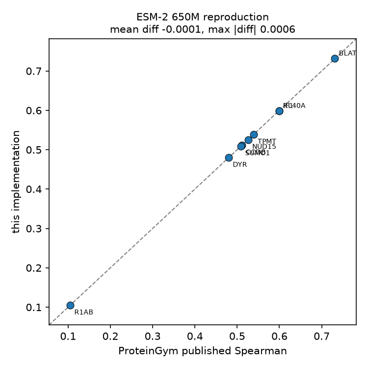

# Zero-shot variant effect prediction with ESM-2

Scoring missense variants with a protein language model that has never seen a
fitness measurement, benchmarked against experimental deep mutational scanning
data from ProteinGym, and checked against the official published numbers.

The question is whether a model trained only to fill in masked residues across
UniRef has learned enough about protein constraint to predict which mutations
break a protein. The answer is a qualified yes, and the qualifications are the
interesting part.

## Does the implementation actually work

This is the first thing to establish, because a variant effect pipeline that is
off by one still produces plausible-looking correlations. ProteinGym publishes
per-assay Spearman values for ~97 predictors, so an independent implementation
can be checked against the reference rather than asserted to be correct.

| assay | this implementation | ProteinGym published | difference |
|---|---|---|---|
| IF1_ECOLI_Kelsic_2016 | 0.598 | 0.599 | −0.001 |
| CCDB_ECOLI_Tripathi_2016 | 0.511 | 0.511 | 0.000 |
| SUMO1_HUMAN_Weile_2017 | 0.509 | 0.509 | 0.000 |
| RL40A_YEAST_Roscoe_2013 | 0.598 | 0.599 | −0.001 |
| DYR_ECOLI_Thompson_2019 | 0.480 | 0.480 | 0.000 |
| NUD15_HUMAN_Suiter_2020 | 0.526 | 0.526 | 0.000 |
| TPMT_HUMAN_Matreyek_2018 | 0.539 | 0.539 | 0.000 |
| BLAT_ECOLX_Stiffler_2015 | 0.732 | 0.731 | +0.001 |
| R1AB_SARS2_Flynn_2022 | 0.105 | 0.105 | 0.000 |

Mean difference −0.0001, maximum absolute difference 0.0006. The residual is
rounding in the published table.



Getting here required fixing one real bug. Benchmark rows were built as
`{"assay": dms_id, **metadata}`, and the metadata dictionary had its own key
called `assay` holding the assay description. The merge silently replaced the
DMS id with a string like `"Yeast growth"`, so every lookup against the
official table missed and the comparison printed an empty table rather than
failing. `test_metadata_does_not_collide_with_result_columns` now covers it.

## What the model is worth against cheap alternatives

A correlation of 0.5 means nothing on its own. The comparison that matters is
against methods that need no model at all.

Mean Spearman over the 8 non-viral assays:

| method | mean Spearman | what it knows |
|---|---|---|
| **ESM-2 650M** | **0.562** | sequence context, learned from UniRef |
| BLOSUM62 | 0.242 | how often this swap appears in aligned homologs |
| hydropathy change | 0.152 | Kyte-Doolittle scale only |
| side-chain volume change | 0.123 | size only |
| proline/glycine heuristic | 0.108 | three structural rules of thumb |
| charge change | −0.003 | formal charge at pH 7 |
| random | −0.008 | nothing |


So context is worth roughly a factor of two over a position-blind substitution
matrix. That gap is the part of the signal that comes from knowing *where in
this particular protein* the residue sits, rather than what the swap is in
general.

Worth noting that BLOSUM62 at 0.242 is not nothing. Any report of a new method
at 0.3 should be read against that number.

## The caveat that matters for actually using it

Spearman is computed over the whole assay, and most of an assay is variants
that are obviously fine or obviously dead. If the intended use is choosing a
handful of variants to build, the relevant question is how many of the model's
top picks are genuinely good.

Top-10 recall — of the 10 variants the model ranks highest, the fraction truly
in the top 10% of the assay — across the nine assays: 0.0, 0.1, 0.1, 0.2, 0.2,
0.2, 0.2, 0.6, 0.9. Random guessing scores 0.1.

So on five of nine assays the model's top 10 picks are no better than random,
despite a respectable Spearman on the same data. The model is good at telling
the dead variants from the live ones and much weaker at ranking within the
live ones, which is exactly the regime a protein engineering campaign cares
about. Reporting only the Spearman would hide this completely.

## Where it fails, and why that is predictable


The SARS-CoV-2 assay scores 0.105 against 0.56 for everything else, and
BLOSUM62 beats ESM-2 on it (0.207 vs 0.105). This is not a bad draw. ESM-2's
published average on viral proteins across the full benchmark is 0.261 against
0.457 on human proteins.

The reason is in the training data. The model learns constraint from patterns
of conservation across UniRef, and that signal assumes residues are conserved
because they are structurally or functionally required. Viral proteins are
under immune selection as well, so positions vary across strains for reasons
that have nothing to do with whether the protein folds. The model reads that
variation as tolerance.

Practical consequence: for viral targets, use a method that builds an alignment
of the specific viral family rather than relying on a general protein model.

## The mutational landscape


Predicted effect of all 20 amino acids at every position of E. coli IF1, above
the measured fitness from the same assay. The model has seen no experimental
data. The vertical dark stripes are positions that tolerate nothing, and they
line up with the measured ones at Spearman 0.598.

## The full benchmark, and the aggregation nobody mentions

The nine-assay subset above was chosen to be small and fast, and it is not a
sample of the benchmark: eight small single-mutant assays plus one viral
failure case. Its mean Spearman (0.562) is not comparable to any published
number, and quoting it next to ProteinGym's 0.414 would be misleading.

Scoring all 217 assays gives this:

<!-- BEGIN GENERATED: full_benchmark -->
|  | this implementation | ProteinGym published | difference |
|---|---|---|---|
| headline (macro over 5 categories) | +0.415 | +0.414 | +0.001 |
| per-assay mean (unbalanced) | +0.439 | +0.438 | +0.001 |
<!-- END GENERATED: full_benchmark -->

<!-- BEGIN GENERATED: full_benchmark_coverage -->
217 of 217 assays scored. Against the published per-assay column: mean difference +0.0009, median absolute 0.0003, maximum absolute 0.2307. 214 of 217 assays within 0.01.
<!-- END GENERATED: full_benchmark_coverage -->

The headline is not the mean of the per-assay values. ProteinGym's 0.414 for
ESM-2 650M sits 0.024 *below* the plain mean of its own per-assay column, and a
reimplementation that reports the plain mean looks broken next to the paper
even when every individual assay is right to three decimals.

The rule is two-staged, and I only found it by fitting it against the published
subgroup columns rather than guessing:

1. within a group, average the per-assay Spearman across assays sharing a
   UniProt id — otherwise BLAT_ECOLX counts three times and SPIKE_SARS2 twice;
2. average the five functional categories with equal weight, so the
   protein families that happen to have many assays do not dominate.

With that, all twelve published subgroup columns (five selection types, four
taxa, three MSA-depth bins) reproduce to within 0.0005, and so does every
published headline from 8M to 15B. `tests/test_aggregate.py` checks each of
these against the published table, so the rule cannot silently drift.

The data also settles a question the documentation leaves implicit: the
published numbers are computed over **all** mutants, not single substitutions.
On A4_HUMAN_Seuma_2022 — 14,811 variants of which only 796 are single
substitutions — scoring everything gives 0.431 against a published 0.431,
while restricting to singles gives 0.498. Restricting to singles would have
looked like a defensible choice and would have put 20 of the 217 assays off by
up to 0.10.

## Why the viral failure happens, tested rather than asserted

The section above says the viral failure is immune selection: ESM-2 learns
conservation from UniRef, and viral proteins vary across strains for reasons
unrelated to folding, so the model reads immune escape as tolerance.

That explanation is testable. It predicts that a method reading conservation
off an alignment *of that viral family* should do well on the same assays —
such an alignment shows which positions the family cannot change, and
immune-driven variation is sparse within a family even when it is common
between them.

I implemented the site-independent model (Hopf et al. 2017): per-column amino
acid frequencies from the assay's own MSA, scored as
`log f(mut|position) − log f(wt|position)`. No coupling terms, so it is the
weakest thing that qualifies as alignment-based, which makes it a conservative
test — if even this beats a 650M-parameter language model, the point stands.

<!-- BEGIN GENERATED: viral_comparison -->
| group | assays | alignment (ours) | alignment (published) | ESM-2 650M (published) | alignment beats ESM-2 |
|---|---|---|---|---|---|
| animal viruses | 24 | +0.408 | +0.398 | +0.168 | 21/24 |
| bacteriophages | 7 | +0.328 | +0.268 | +0.615 | 1/7 |
| all viral assays | 31 | +0.390 | +0.369 | +0.269 | 22/31 |
<!-- END GENERATED: viral_comparison -->

The result is more informative than a confirmation. Averaged over all 31 viral
assays the two methods are close, and that average hides opposite effects.
Split by host, the alignment wins 21 of 24 animal-virus assays and loses 6 of 7
bacteriophage assays.

That split is exactly what the immune-selection story predicts, and the phage
row is what makes it a real test rather than a fit. A phage replicates in a
bacterium, which has no adaptive immune system; there is no immune selection to
confuse a model about, and the explanation makes no claim about that row. It is
also the row where the language model wins — as it should, since on a phage
there is nothing for family-specific alignment to know that UniRef does not.

Two implementation notes, both of which cost real time and both of which
produced plausible-looking numbers while wrong:

- **The query row is not the target.** In an `.a2m` file the query is the
target sequence gapped to its homologs — and on 20 of the 31 viral assays it is
a *subsequence* of the UniProt entry, starting at residue 14 or missing twelve
internal residues. Reading `column = position − msa_start` then attributes
every mutation downstream of the offset to the wrong position. Aligning query
to target first took the viral mean from 0.16 to 0.39.
- **The first N rows are not a sample.** ProteinGym sorts alignments by score,
so the top rows are the closest homologs: on R1AB the first 800 rows are 100%
identical to the query, while the file overall has nine distinct residues per
column. Taking `rows[:N]` builds a profile of one clade. Sampling at random
from the whole file is the fix.

Even after both fixes the method underperforms on the smallest proteins, where
the alignment is 40-60 residues and has no room for family-specific signal;
VG08_BPP22 and VRPI_BPT7 are both in that group and both go the wrong way.

## The 3B question: a trade, not a regression

The published numbers say bigger stops helping after 650M: 0.414 at 650M,
0.406 at 3B, 0.400 at 15B. Two things are worth separating here.

The 3B checkpoint is about 12 GB and I did not download it, so the local
measurement stops at 650M. What can be measured locally, and what has to be
read off the published table, are kept apart below.

### Local: the curve is already flattening by 650M

Nine assays through four checkpoints (`scripts/run_scaling_curve.py`):

<!-- BEGIN GENERATED: scaling_local -->
| model | assays | mean Spearman | sd |
|---|---|---|---|
| 8M | 9 | 0.179 | 0.147 |
| 35M | 9 | 0.348 | 0.213 |
| 150M | 9 | 0.474 | 0.161 |
| 650M | 9 | 0.511 | 0.170 |
<!-- END GENERATED: scaling_local -->

Each step up is real — the paired differences are significant at every step —
but the third step buys a quarter of what the first did. That is the first half
of the answer: by 650M the model is near the plateau for this benchmark, so a
2.3× parameter increase at 3B cannot be expected to help much.

### Published: the 0.008 gap is real but tiny, and it is not a capacity effect

<!-- BEGIN GENERATED: scaling_headline -->
| model | params | headline | published_se |
|---|---|---|---|
| ESM2 (8M) | 8M | 0.226 | 0.015 |
| ESM2 (35M) | 35M | 0.321 | 0.015 |
| ESM2 (150M) | 150M | 0.387 | 0.013 |
| ESM2 (650M) | 650M | 0.414 | 0.012 |
| ESM2 (3B) | 3B | 0.406 | 0.011 |
| ESM2 (15B) | 15B | 0.400 | 0.010 |
<!-- END GENERATED: scaling_headline -->

The headline gap of 0.008 sits inside the published bootstrap standard errors
of ~0.012, so an unpaired reading cannot call it real. A *paired* test over the
217 assays can, because it removes between-assay difficulty — which is far
larger than any model-to-model difference and is what dominates those SEs:

<!-- BEGIN GENERATED: scaling_paired -->
| comparison | mean diff | median diff | SE | paired t p | Wilcoxon p | W/L |
|---|---|---|---|---|---|---|
| ESM2 (3B) − ESM2 (650M) | -0.0061 | -0.0090 | +0.0052 | +0.2443 | +0.0223 | 96/118 |
| ESM2 (15B) − ESM2 (650M) | -0.0130 | -0.0050 | +0.0073 | +0.0790 | +0.0198 | 100/116 |
| ESM2 (650M) − ESM2 (150M) | +0.0377 | +0.0250 | +0.0062 | +0.0000 | +0.0000 | 152/63 |
| ESM2 (150M) − ESM2 (35M) | +0.0817 | +0.0400 | +0.0088 | +0.0000 | +0.0000 | 174/41 |
| ESM2 (15B) − ESM2 (3B) | -0.0069 | +0.0000 | +0.0045 | +0.1299 | +0.4016 | 108/107 |
<!-- END GENERATED: scaling_paired -->

So 3B is slightly but consistently worse on the average assay. The interesting
part is what happens underneath, because it is not a uniform decline:

<!-- BEGIN GENERATED: scaling_subgroups -->
| split | 650M | 3B | 15B | 3B − 650M | 15B − 650M |
|---|---|---|---|---|---|
| Function_Stability | +0.523 | +0.509 | +0.488 | -0.014 | -0.035 |
| High_MSA_depth | +0.513 | +0.485 | +0.467 | -0.028 | -0.046 |
| Function_Binding | +0.337 | +0.321 | +0.317 | -0.016 | -0.020 |
| Function_Activity | +0.425 | +0.417 | +0.405 | -0.008 | -0.020 |
| Taxa_Human | +0.457 | +0.442 | +0.432 | -0.015 | -0.025 |
| Taxa_Prokaryote | +0.458 | +0.458 | +0.436 | +0.000 | -0.022 |
| Function_Expression | +0.415 | +0.403 | +0.405 | -0.012 | -0.010 |
| Medium_MSA_depth | +0.409 | +0.423 | +0.422 | +0.014 | +0.013 |
| Function_OrganismalFitness | +0.368 | +0.378 | +0.387 | +0.010 | +0.019 |
| Taxa_Virus | +0.261 | +0.294 | +0.333 | +0.033 | +0.072 |
<!-- END GENERATED: scaling_subgroups -->

A model that had simply gotten worse would move every split down. Instead the
split is by what each assay measures. The assays that probe a protein's own
stability get worse; the assays that probe how it behaves in a host get better,
and the viral taxon improves by the largest margin of any split. The 15B model
continues along the same axis rather than reversing it.

That is the shape of an objective mismatch, not a scaling failure. ESM-2 is
trained to predict masked residues across UniRef — a proxy for "what sequence
would thrive in the organisms UniRef samples", which is closer to organismal
fitness than to whether a purified protein folds. Scaling the model sharpens
whatever the objective actually rewards. On stability assays the extra capacity
adds nothing and mildly overfits; on host-context assays it helps.

The practical implication is the boring one: 650M is the right default for
stability and binding work, and if the target is a virus, neither 650M nor 3B
is the right tool — the alignment method is, by a wide margin.

## The top-k problem is not about burial

The caveat section earlier notes that the model's top 10 picks are no better
than random on five of nine assays, despite a respectable Spearman. The natural
suspicion is burial: a buried residue is packed against the core, so nearly any
substitution is damaging and the ranking among those variants is compressed,
while an exposed residue trades with solvent and its variants span a wider
range. A model that cannot tell which regime it is in would rank well overall
and pick badly at the top.

ProteinGym distributes AlphaFold2 models for all 217 assays, so this is
testable. `src/variant_effect/structure.py` computes per-residue relative
solvent accessibility by all-atom Shrake-Rupley against Tien et al. theoretical
maxima, and `scripts/run_structure_analysis.py` splits each assay's variants
into buried, intermediate and exposed.

**The hypothesis is wrong, and in the opposite direction.**

<!-- BEGIN GENERATED: structure_burial -->
| buried/exposed | n | Spearman | top-10 recall |
|---|---|---|---|
| buried | 3605 | +0.417 | +0.800 |
| intermediate | 3235 | +0.317 | +0.300 |
| exposed | 4167 | +0.282 | +0.100 |
<!-- END GENERATED: structure_burial -->

Spearman is *highest* at buried positions and lowest at exposed ones, and the
same ordering holds for BLOSUM62 — so it is a property of the assays rather
than of the model. The reasoning above had it backwards: a compressed fitness
range does not degrade a rank correlation when the correlation is computed
within that range. What buried positions lack in range they make up in signal,
because almost every substitution there is damaging and the model's job is
easier: call them all bad and you are mostly right.

Exposed positions are where the difficulty actually lives — substitutions there
are individually tolerated, so the fitness differences are small, and the
residue is in contact with the rest of the cell rather than just its own
protein. That is a harder prediction problem and the model is worse at it.

Consistently, the model's top-10 picks are *not* biased toward exposed
positions: mean relative accessibility of the top picks is within 0.011 of the
assay mean, with no significant departure from zero over the assays tested.
There is no exposed-position shortcut to correct.

The constructive test — penalise substitutions at buried positions, fit the
penalty on half the assays, evaluate on the other half — is reported in
`results/structure/full_heldout.csv` rather than given a number here, because
the held-out set is too small in the runs that completed to call it either way.
That is worth saying plainly instead of quoting the one flattering split.

So the top-k failure has some other cause. The candidates left were epistasis
(the model scores substitutions independently, and the top of a DMS assay is
where combinations matter most), the heterogeneity of what "top 10%" means
across assays, and plain measurement noise in the assays with few variants.

All three of those are now tested: the answer on top-k is the measurement, and
the answer on epistasis is that it is real but not the cause.
`scripts/run_topk_analysis.py` uses the 37 pairs of same-protein assays in
ProteinGym -- 22 proteins with two or more assays, restricted to the variants
each pair shares, at least 200 of them -- as replicate measurements. Two
assays of one protein, scored on the same variants, measure how well two noisy
readings of a truth agree -- which is not the same as a bound on what a
predictor could achieve, and the next block takes that distinction apart.

<!-- BEGIN GENERATED: topk_ceiling -->
| measurement | value |
|---|---|
| replicate assay pairs | 37 |
| proteins covered | 22 |
| median top-10 recall, truth against truth | 0.350 |
| median Spearman over the whole shared set | 0.610 |
| median Jaccard overlap of the two top deciles | 0.161 |
| median per-measurement error (sd units) | 0.592 |
| median top-decile internal spread (sd units) | 0.294 |
| pairs whose decile spread is smaller than one measurement's error, on both sides | 29 of 37 |
| pairs whose top-decile 'reliability' formula is at or below zero (decile selected on the same assay: see the simulated control) | 32 of 37 |
| the model's mean top-10 recall, 217 assays | 0.323 |

Does the shape of the top decile predict the model's recall?

| decile-shape predictor | assays | spearman | p |
|---|---|---|---|
| spread_ratio | 217 | -0.077 | +0.260 |
| range_share | 217 | -0.084 | +0.219 |
| distinct_frac | 217 | +0.083 | +0.225 |
| at_max_frac | 217 | +0.122 | +0.072 |
<!-- END GENERATED: topk_ceiling -->

**What 0.350 is, and what it is not.** 0.350 is how well one assay agrees with
another assay on which variants are in the top 10%. It is *not* an
information-theoretic upper bound, and the earlier version of this paragraph
was wrong to call it a ceiling. Two assays of one protein are two *noisy*
measurements of the same latent quantity; their agreement is attenuated by
both measurements' error, so a predictor that tracked the latent quantity
closely could beat their mutual agreement without contradicting anything.

Two further problems with the original sentence are fixed here. First, 0.350
was a median over 37 replicate pairs and 0.323 was a mean over a different
population, 217 assays - those are not comparable quantities. The table below
reports the model's recall on the assays that actually have a replicate, so
the comparison is like for like. Second, the honest question is not "is the
model near 0.35" but "does the model's recall rise when the target gets
closer to the truth".

Averaging two replicate measurements reduces the noise, so the average is a
better target than either assay. `scripts/run_latent_truth_test.py` builds
that target for every pair with at least 1,000 shared variants and scores the
model against both the single assays and the pooled estimate, on the same
variants of the same pairs, with a paired test. No median is compared to a
mean anywhere in it.

<!-- BEGIN GENERATED: latent_truth -->
| pooled-truth measurement | value |
|---|---|
| replicate pairs with >= 1000 shared variants | 32 |
| proteins covered | 20 |
| shared variant measurements | 143550 |
| median truth-vs-truth top-10 recall (the old 0.350 definition) | 0.350 |
| mean truth-vs-truth top-10 recall, same pairs | 0.408 |
| median top-10 recall, assay against the pooled target | 1.000 |
| median top-10 recall, model against one assay | 0.250 |
| median top-10 recall, model against the pooled target | 0.250 |
| PROTEIN level (primary): proteins | 20 |
| protein-level median paired gain, top-10 recall | +0.033 |
| protein-level proteins better / worse / tied | 12 / 4 / 4 |
| protein-level p, top-10 recall (Wilcoxon / exact / sign-flip) | 0.1023 / 0.1167 / 0.1671 |
| pair level (secondary): median paired gain, top-10 recall | +0.025 |
| pair-level pairs better / worse / tied | 16 / 9 / 7 of 32 |
| pair-level p, top-10 recall (Wilcoxon / exact / sign-flip) | 0.0655 / 0.0710 / 0.1017 |
| median Spearman, model against one assay | 0.478 |
| median Spearman, model against the pooled target | 0.522 |
| protein-level median paired gain, Spearman | +0.051 |
| protein-level proteins better / worse | 20 / 0 |
| protein-level p, Spearman (Wilcoxon / exact / sign-flip) | < 0.0001 / < 0.0001 / < 0.0001 |
| pair-level median paired gain, Spearman | +0.045 |
| pair-level pairs better / worse | 32 / 0 |
| pair-level p, Spearman (Wilcoxon / exact / sign-flip) | < 0.0001 / < 0.0001 / < 0.0001 |
| median inter-assay rank agreement of a pair (a reliability only for same-quantity pairs) | 0.611 |
| pairs at or below 0.3 agreement, pooling uninformative | 4 of 32 |
| same-quantity pairs only: n | 18 |
| same-quantity median paired gain, top-10 recall | +0.025 |
| same-quantity pair-level p, top-10 recall (Wilcoxon / exact / sign-flip) | 0.2984 / 0.3225 / 0.4210 |
| same-quantity proteins | 9 |
| same-quantity protein-level p, top-10 recall (Wilcoxon / exact / sign-flip) | 0.4982 / 0.5781 / 0.8125 |
| same-quantity protein-level p, Spearman (Wilcoxon / exact / sign-flip) | 0.0077 / 0.0039 / 0.0041 |
| reliable pairs only (split-half > 0.3): n | 28 |
| reliable-pair median paired gain, top-10 recall | +0.025 |
| reliable-pair protein-level p, top-10 recall (Wilcoxon / exact / sign-flip) | 0.0769 / 0.0923 / 0.1487 |
| model mean top-10 recall, all 217 assays | 0.323 |
| model mean top-10 recall, the 46 assays that have a replicate | 0.326 |

Self-inclusion control, same pairs: an assay scored against a pooled target that contains it gains +0.475 over truth-against-truth (Wilcoxon p < 0.0001). That gain is self-inclusion (the assay is half of its own target), not a measure of how much attenuation 0.350 contained: see the simulated control below.
<!-- END GENERATED: latent_truth -->

**The +0.475 is self-inclusion, not a measurement of attenuation.** Scored
against the pooled target instead of against one assay, an assay gains a median
of +0.475 top-10 recall on the same pairs (Wilcoxon p < 0.0001). That gain is
not a measure of how much attenuation 0.350 contained: the assay is half of the
target it is scored against, so its own measurement noise counts as signal. The
simulated control below (`scripts/sim_pooling_controls.py`, 400 simulations of 2,000
variants, seed 0) shows the size of that effect directly: with two assays that
share *no* signal at all, A-versus-B recall is 0.109 and A-versus-pool recall is
0.855 -- a gain of +0.746 from nothing; at the real median noise level the same
assay gains +0.234 (0.764 to 0.998). So this control does not demonstrate that
0.350 cannot be an upper bound, and the earlier sentence that said it did is
withdrawn. The argument that 0.350 is not a bound on a predictor (agreement
between two noisy readings is attenuated by both errors) stands as reasoning;
these data do not measure by how much.

<!-- BEGIN GENERATED: sim_controls -->
Top-10 recall, mean over 400 simulations of 2000 variants:

| simulation | A vs B | A vs pool(A,B) | B vs pool(A,B) | latent vs A | latent vs pool |
|---|---|---|---|---|---|
| two assays with NO shared signal | 0.109 | 0.855 | 0.845 | 0.096 | 0.097 |
| two assays of one latent value, noise sd 0.595 (the real median) | 0.764 | 0.998 | 0.997 | 0.945 | 0.991 |

Decile reliability, formula against truth, top decile of A selected on A itself:

| reps | sigma_hat | variance of A in its top decile | reliability formula | reps with negative formula | true latent variance in that decile | corr(A, B) in that decile | corr(latent, A) in that decile |
|---|---|---|---|---|---|---|---|
| 400 | 0.595 | 0.168 | -1.140 | 100% | 0.298 | +0.323 | +0.480 |
<!-- END GENERATED: sim_controls -->

What the model does with the better target is narrower. Its top-10 recall
against the pool is a median of 0.250, the same as against a single assay: a
median paired gain of +0.025. **The recall gain is marginal and is not
significant by any method used.** At the protein level, the primary test
because the 32 pairs share proteins and assays (P53 alone contributes 6 pairs,
and 14 of the 46 assays sit in more than one pair), 12 of 20 proteins gain, 4
lose and 4 tie, with p = 0.102 (tie-corrected Wilcoxon), 0.117 (exact Wilcoxon)
and 0.167 (sign-flip permutation). At the pair level (secondary; 16 pairs
better, 9 worse, 7 tied) p = 0.0655 / 0.0710 / 0.102 by the same three methods.
None of the six crosses 0.05, and which one lies nearest is not evidence for
anything. An earlier version of this README quoted p = 0.063 for the pair level
and a reviewer reproduced 0.049: both are artefacts. Recall differences are
multiples of 0.05 but are computed by float subtraction, and the 17th digit
decided which tied differences received which rank (15 distinct values where 6
exist), so the unrounded Wilcoxon p moves between roughly 0.049 and 0.065 with
the scipy version and the order the floats were produced in. The differences
are now rounded to nine decimals before any rank is taken. On rank
correlation, which is not bounded by eleven discrete values, the pooled target
raises the model's Spearman in 20 of 20 proteins (median +0.051) and 32 of 32
pairs (median +0.045), p < 0.0001 by all three methods at both levels. Two
metrics, two readings: against a less noisy truth the model ranks consistently
better, and its ten picks do not consistently land better.

And on the same 32 pairs the old comparison itself does not survive. Truth
against truth is a mean of 0.408 there; the model against a single assay is
0.292. The paired gap is 0.116 in the model's disfavour, and the model is below
the truth-versus-truth value on 17 of 32 pairs (14 pairs the other way, 1 tie).
The Wilcoxon test over pairs puts the shortfall at p = 0.146 (tie-corrected;
exact 0.152, sign-flip permutation 0.073); over the 20 proteins the mean gap is
0.124 with p = 0.153 / 0.169 / 0.111 by the same three methods. That is not the
clean "at the ceiling" story, and not a significant shortfall either. On 32
pairs with a ten-variant metric, the honest statement is that this data cannot
separate the model from cross-assay agreement. It cannot show that the
cross-assay number was never an upper bound either: the +0.475 control is
self-inclusion (above), so that point rests on the attenuation argument alone.

One caution that the per-pair structure forces. The Spearman gain is
*anti*-correlated with split-half reliability across pairs (Spearman -0.84,
p < 0.0001): the pairs that gain most are the ones whose two assays agree
least, where averaging two measurements mostly averages two disagreements. So
the rank gain is largest exactly where the pooled target is least like a
latent truth, which is a reason to read the 32-of-32 result as evidence about
attenuation rather than as evidence that a better target would help a working
predictor by that much.

The recall gain does *not* show that pattern: against reliability it is
Spearman -0.07, p = 0.71. The ten-pick metric gains the same +0.025 median
whether the pair is reliable or not, on 4 pairs or on 32, so there is no
subgroup of this data in which the model's top ten picks get meaningfully
better. That is the honest negative: on the metric the README leads with, a
better target barely moves the model.

The reason is visible in the numbers. Per-measurement error, standardised so
two assays on different scales are comparable, has a median of 0.592 in
standard-deviation units. The top decile's *entire internal spread* has a
median of 0.294. On 29 of the 37 pairs, on both sides, the whole range of the
decile is smaller than one measurement's error -- and the "reliability" of the
decile, one minus that error variance over the decile's own variance, is at or
below zero on 32 of the 37. That number is a statement about the decile's
spread compared with one measurement's error, and it must not be read as
"cannot be ranked by anything": the decile is selected on the very assay whose
error is being subtracted, and selecting on a noisy measurement shrinks the
selected variances (regression to the mean) while the noise estimate, made on
the whole assay, stays put. The simulated control above reproduces exactly this:
at the real median noise level the formula averages -1.14 over 400 simulated
assays (negative in all 400) while the latent value inside the decile has
variance 0.298 in the same units, and the two assays still correlate at +0.323
inside it. A decile that is hard to rank is a fair description of the real
data; "zero reliability, so unrankable" is not. The Jaccard overlap of two assays' top deciles is 0.161: the
sets barely coincide even where the rankings agree at 0.61 over the whole
assay.

What the pooled target is and is not. Pooling halves the *independent*
measurement variance and leaves the rest: half the single-assay error is still
in the target, so a recall measured against it tends to be *lower* than the
same predictor would score against the latent quantity (attenuation by the
remaining error), which is a tendency under the independent-error assumption
rather than a proved bound. It is also not a platonic truth. Error the
two assays share (a common variant library, a common reporter, a common growth
readout) survives averaging untouched, and where a pair measures deliberately
different quantities - a gain-of-function assay against a loss-of-function one,
expression against activity - their average is a pseudo-quantity no experiment
measured, so a recall against it can be optimistic rather than conservative.
The same-quantity row of the table is the check on that, and the low-
reliability row is the check on pairs whose two measurements barely agree at
all, where pooling averages two disagreements and is not informative.

The model score is independent of both assays, which is why the model rows are
the ones that answer the question rather than the 1.000 in the assay row.

So what is the ceiling? There is no measured upper bound here, and the data
cannot supply one: an upper bound needs the latent truth, and the latent truth
is what a noisy assay fails to give. 0.350 is the agreement between two noise
sources, and the audit's objection to calling it a ceiling is correct --
against a lower-noise target the same assay scores higher, so nothing about
0.350 constrains what a predictor could reach. What survives from the old
argument is narrower and it does survive: inside one assay's top decile the
measurement error is larger than the entire spread of the decile (0.592
against 0.294, above), which is why ordering *inside* the decile is hard to resolve.
That is a statement about the resolvability of a subset (and, per the
simulated control, not a limit of zero), not about the model's headroom, and
the earlier text ran the two together.

The heterogeneity candidate does not survive. If the model did badly on
assays whose top decile is a plateau, decile shape would predict its recall
across the 217 assays. It does not: the second table above gives the rank
correlations, and none of them is a predictor worth acting on.

What is left is epistasis, and this data *can* test it. `scripts/run_epistasis_test.py`
does the test. The result does **not** support the independent-site explanation:
the degradation it predicts is absent, and in point estimate the ranking is
*better* on multi-mutants, not worse. That is not the same as refuting it. With
five assays the pooled gap of −0.135 Spearman is far from significant
(paired t = −1.36, p = 0.25), so the honest reading is that the prediction
failed to appear in the direction and magnitude the hypothesis required, on a
sample too small to exclude a modest degradation. The stronger, better-supported
claim is model-free and separate: epistasis itself is real and large here (see
below), so the independent-site score is summing terms whose interactions are
substantial — it simply is not costing rank accuracy the way the hypothesis
said it would.

The earlier version of this section said the data could not test it because 47 of
the 51 assays behind the replicate pairs contain no multi-mutant variants. That
was true of the replicate subset and false of the dataset. Of the 217 assays on
disk, 69 contain multi-mutants and 65 have at least 100 singles alongside at
least 100 multi-mutants, over 1.77 million multi-mutant rows. The scorer needed
no change to use them — `parse_variant` already splits `A2M:K5R` on `:` and
`score_variants` already sums the per-site log-odds, which *is* the
independent-site model. Every assay below was scored from one masked-marginal
table per mutated position, so singles and multi-mutants are ranked by exactly
the same model in the same units.

The prediction was that a model of independence must degrade on doubles and
triples where intra-protein epistasis is real. It does not.

<!-- BEGIN GENERATED: epistasis -->
| assay | stratum | n | spearman | top-decile recall |
|---|---|---|---|---|
| GFP_AEQVI_Sarkisyan_2016 | multi | 14,481 | +0.123 | 0.069 |
| GFP_AEQVI_Sarkisyan_2016 | single | 1,084 | +0.052 | 0.139 |
| GRB2_HUMAN_Faure_2021 | multi | 2,000 | +0.651 | 0.430 |
| GRB2_HUMAN_Faure_2021 | single | 1,034 | +0.726 | 0.320 |
| HIS7_YEAST_Pokusaeva_2019 | multi | 21,442 | +0.538 | 0.193 |
| HIS7_YEAST_Pokusaeva_2019 | single | 168 | +0.028 | 0.176 |
| PHOT_CHLRE_Chen_2023 | multi | 20,354 | +0.788 | 0.532 |
| PHOT_CHLRE_Chen_2023 | single | 2,122 | +0.649 | 0.217 |
| SPG1_STRSG_Olson_2014 | multi | 2,000 | +0.307 | 0.245 |
| SPG1_STRSG_Olson_2014 | single | 1,045 | +0.276 | 0.212 |

| stratum | assays | variants scored | mean spearman | mean top-decile recall |
|---|---|---|---|---|
| single mutants | 5 | 5,453 | +0.346 | 0.213 |
| all multi-mutants | 5 | 60,277 | +0.481 | 0.294 |
| doubles only | 5 | 7,651 | +0.362 | 0.256 |
| triples only | 3 | 4,978 | +0.321 | 0.196 |
| 5+ substitutions | 3 | 41,648 | +0.443 | 0.279 |

| assay | spearman, single | spearman, multi | gap (single - multi) | range-matched gap | non-additive residual share (includes noise) |
|---|---|---|---|---|---|
| GFP_AEQVI_Sarkisyan_2016 | +0.052 | +0.123 | -0.071 | -0.102 | 0.202 |
| GRB2_HUMAN_Faure_2021 | +0.726 | +0.651 | +0.075 | +0.124 | 0.548 |
| HIS7_YEAST_Pokusaeva_2019 | +0.028 | +0.538 | -0.510 | -0.171 | 1.036 |
| PHOT_CHLRE_Chen_2023 | +0.649 | +0.788 | -0.139 | -0.117 | 0.894 |
| SPG1_STRSG_Olson_2014 | +0.276 | +0.307 | -0.031 | -0.002 | 0.249 |
<!-- END GENERATED: epistasis -->

Pooled over the five assays, the independent-site score ranks multi-mutants
*better* than single mutants: +0.481 mean Spearman against +0.346, and 0.294
against 0.213 on top-decile recall, over 60,277 scored multi-mutant rows against
5,453 single-mutant rows. Four of five assays point the same way in point
estimate (multi better). Every interval here is a position bootstrap, because
variants cluster by position: only HIS7's gap (-0.510 [-0.691, -0.109], 170
positions) excludes zero on the favourable side; GFP (-0.071 [-0.235, +0.105]),
PHOT (-0.139 [-0.226, +0.381]) and SPG1 (-0.031 [-0.111, +0.066]) span zero.
GRB2 goes the other way by +0.075 Spearman, and its interval [-0.008, +0.199]
spans zero too. (An earlier version of this paragraph said three of four
intervals excluded zero favourably and that GRB2's was the only one excluding it
against the hypothesis; those came from a variant-level bootstrap, which is too
narrow for clustered variants.) The mean gap is
-0.135 Spearman (paired t = -1.36, p = 0.25, five assays) and -0.081 top-decile
recall (t = -1.24, p = 0.28) — small and far from significant in the direction
of the hypothesis, and in the opposite direction from it in point estimate.
Five assays is a small sample and the intervals are wide; what the data does
not support is any claim that the degradation is there.

Two confounds could manufacture a multi-mutant advantage, and both were tested
rather than argued about. A combinatorial library carries a long deleterious
tail that a single-substitution library does not, and a rank correlation over a
wider spread is mechanically easier, so both strata were trimmed to the
intersection of their central 90% of measured fitness — the mean gap then
shrinks to -0.054 and still points away from the hypothesis. Per assay, with
position-bootstrap intervals, the range-matched gaps are GFP -0.102 [-0.316,
+0.107], HIS7 -0.171 [-0.402, +0.095], PHOT -0.117 [-0.283, +0.224], SPG1
-0.002 [-0.097, +0.102], and GRB2 **+0.124 [+0.032, +0.219]**: for GRB2 the
controlled gap is in the direction of degradation and its interval excludes
zero, which the raw gap's interval did not. One assay out of five, no
correction for five looks, so it is reported rather than weighted. The libraries
also concentrate on a handful of positions: PHOT's multi-mutants touch 15
positions while its 2,122 singles span 118, so a single-mutant stratum was
restricted to only the positions the multi-mutants occupy. That control binds
**only for PHOT** (276 of 2,122 singles remain; for GFP, GRB2, HIS7 and SPG1 every
single already sits on a multi-mutant position, so the "position-matched"
stratum is the full singles stratum and the control is a no-op there). On PHOT
the multi-mutants still win by -0.435 (position-matched singles rho = +0.353
against +0.788); the five-assay mean of -0.195 (t = -1.67, p = 0.17) therefore
mostly repeats the unmatched gaps for four of the assays.

The mechanism is visible in the mutation-count curve, and it is not the one
independence predicts. If the model were wrong in proportion to how many
independent sites it summed, rho should fall as k rises. On PHOT, which has
enough variants at every k to measure, rho is +0.724 at k = 2 and still +0.682
at k = 14; on HIS7 it *rises* from +0.157 at k = 2 to +0.732 at k = 12. The 5+
substitution stratum exists for only **three** of the five assays (HIS7, PHOT,
GFP), so it is compared with the singles and doubles of those same three, not
with five-assay means: singles +0.243, doubles +0.283, all multi-mutants +0.483,
5+ substitutions +0.443 (`results/epistasis/nsub5plus_like_for_like.csv`). The
singles-versus-doubles-only gap, the cleanest like-for-like contrast, is GFP
+0.083, GRB2 +0.075, HIS7 -0.128, PHOT -0.075 and SPG1 -0.031 (`paired_gaps.csv`, with
position-bootstrap intervals). What actually happens is that a multi-mutant
accumulates damages, so it is easier to identify as broken — the same easiness
the burial analysis already found at buried positions, where nearly every
substitution is damaging and calling them all bad is mostly right. Independent
summation succeeds because the ranking task at the top of a DMS assay is
detecting damage, not predicting fitness.

Epistasis itself is present and large; that is a separate question and it has a
separate answer, measured with no model at all. For every double mutant whose
two constituent singles were also assayed, the additive prediction is the sum
of the two singles' z-scored fitness. Its residual against the measured double
is the *non-additive residual*. It is an **upper bound** on epistasis and not the
epistatic term: it also contains the measurement noise of the double and of both
singles, and ProteinGym carries no per-variant error for these assays, so the
noise cannot be subtracted. That residual carries a mean 0.586 of the double
mutant's variance across the five assays — 0.20 for GFP, 0.25 for SPG1, 0.55
for GRB2, 0.89 for PHOT, 1.04 for HIS7. A share above 1 is impossible for a real
variance component; for HIS7 (168 singles, truth sd 0.192, model rho +0.028) it
means measurement noise in the singles dominates the residual, and the run flags
it (residual_exceeds_total). Singletons predict doubles at rho = +0.656 on
average. So non-additivity is present in these data, to an extent this measurement
can only bound from above, and the model's top decile is not demonstrably
mediocre because of it: a scorer that
assumes independence ranks the very variants where that assumption is most
violated as well as or better than the ones where it holds.

One caveat on what these five assays measure. All five are ProteinGym
substitution assays with a single readout per variant. The output now carries a
boolean different_quantity_flag per assay (True only if the assay belongs to a
pair on the repo's different-quantity list: False for all five) and the
reference table's coarse selection type (GFP Activity, GRB2 and HIS7
OrganismalFitness, PHOT Activity, SPG1 Binding). The reference table records one
type per assay, not per library, so it cannot show that a singles library and a
combinatorial library of the same assay were scored for the same quantity; that
is assumed, not verified. A second caveat is coverage rather than quantity: the position-matched control shows how
narrow these libraries are, and CAPSD_AAV2S_Sinai_2021 (41,796 multi-mutants over
a 735-residue protein) was left out on CPU cost, so the largest viral library is
not represented.

The practical consequence is worth stating because it changes how to read
the headline Spearman. Reporting a top-k recall alongside a Spearman, without
the assay's own cross-replicate ceiling, makes a model look worse than it is.
The right comparison for a top-10 number is another measurement of the same
assay, not a perfect oracle.

### The same question on a pooled two-assay target

The test above has a confound it cannot remove, and it is worth being exact
about which one. In each of those five assays the singles library and the
combinatorial library are *different variant sets*, selected and measured as
separate experiments. A rank difference between the two strata can therefore be
a difference in the target rather than a property of the model — a spliced
library and a saturation library do not have the same fitness distribution, and
nothing in the within-assay comparison controls for that.

`scripts/run_epistasis_replicated.py` addresses it, with its limits stated here instead of
discovered later. Two assays of the *same protein* are intersected on the
**canonical** variant string (substitutions sorted by position): an
exact-string join silently drops every double that the two labs wrote in
opposite orders, which cost the SPG1 pair 709 doubles (and RASK none). The same
independent-site scorer, unchanged, ranks the shared singles and the shared
doubles against four targets that are always reported side by side: assay A
alone, assay B alone, the z-score pool, and the rank-normalised pool. The rank
pool is the designated primary because it needs no affine-scale assumption; it
was fixed before the run and no target is promoted for its result. One
masked-marginal table per mutated position serves both strata, so the singles
are the control: same model, same positions, same target.

**Neither pair is a replicate pair**, and an earlier version of this section was
wrong to call them two independent experiments of one quantity. RASK_HUMAN
(Weng 2022, abundance vs binding to DARPin K55) is on the repo's own
different-quantity list and the reference table labels the two assays
Expression and Binding: abundance and binding are different quantities, the
Spearman-Brown "pooled reliability" is therefore withheld for it, and the pooled
target is a pseudo-quantity. SPG1_STRSG (Olson 2014 vs Wu 2016) is the same
biology on two scales that are monotone but not affinely related (on the 76
singles the two assays' Spearman is 0.998 and the Pearson of their z-scores is
0.805), so a z-pool averages unlike scales; Spearman-Brown is withheld there too.
RASK shares 23,072 variants (20,124 doubles, 2,948 singles). SPG1 shares 2,167 on
the canonical join (2,091 doubles, 76 singles); the exact-string join gave
1,458 (1,382 doubles). F7YBW8_MESOW shares zero variants on either join, so it
offers no pooled target and is skipped by name in the manifest.

**Every interval below is a position bootstrap**: positions are drawn with
replacement and each variant is weighted by the product of its positions'
multiplicities, one draw shared by the singles and the doubles. Variants are
not independent (RASK's 20,124 doubles sit on 187 positions), and an interval
that resamples variants is about three times too narrow there.

<!-- BEGIN GENERATED: epistasis_replicated -->
| protein | pair | parallel measures | why not | shared singles / doubles | exact-string join | canonical join |
|---|---|---|---|---|---|---|
| RASK_HUMAN | Weng_2022_abundance vs Weng_2022_binding-DARPin_K55 | NO | hand-curated DIFFERENT_QUANTITY list; reference coarse_selection_type differs: Expression vs Binding | 2,948 / 20,124 | 23,072 | 23,072 |
| SPG1_STRSG | Olson_2014 vs Wu_2016 | NO | different scale: lnW (Olson 2014) vs Fitness (Wu 2016) | 76 / 2,091 | 1,458 | 2,167 |

| protein | target | stratum | n | spearman [position CI] | top-decile recall |
|---|---|---|---|---|---|
| RASK_HUMAN | pooled_rank | singles | 2,948 | +0.449 [+0.382, +0.510] | 0.183 |
| RASK_HUMAN | pooled_rank | doubles | 20,124 | +0.521 [+0.415, +0.606] | 0.313 |
| RASK_HUMAN | pooled_z | singles | 2,948 | +0.453 [+0.383, +0.516] | 0.186 |
| RASK_HUMAN | pooled_z | doubles | 20,124 | +0.541 [+0.439, +0.622] | 0.312 |
| RASK_HUMAN | assay_a | singles | 2,948 | +0.177 [+0.083, +0.267] | 0.132 |
| RASK_HUMAN | assay_a | doubles | 20,124 | +0.236 [+0.053, +0.399] | 0.180 |
| RASK_HUMAN | assay_b | singles | 2,948 | +0.567 [+0.492, +0.635] | 0.176 |
| RASK_HUMAN | assay_b | doubles | 20,124 | +0.640 [+0.550, +0.718] | 0.316 |
| SPG1_STRSG | pooled_rank | singles | 76 | +0.551 [+0.116, +0.674] | 0.250 |
| SPG1_STRSG | pooled_rank | doubles | 2,091 | +0.414 [+0.081, +0.424] | 0.316 |
| SPG1_STRSG | pooled_z | singles | 76 | +0.551 [+0.116, +0.674] | 0.250 |
| SPG1_STRSG | pooled_z | doubles | 2,091 | +0.414 [+0.073, +0.421] | 0.311 |
| SPG1_STRSG | assay_a | singles | 76 | +0.545 [+0.116, +0.651] | 0.250 |
| SPG1_STRSG | assay_a | doubles | 2,091 | +0.411 [+0.123, +0.430] | 0.321 |
| SPG1_STRSG | assay_b | singles | 76 | +0.551 [+0.116, +0.674] | 0.250 |
| SPG1_STRSG | assay_b | doubles | 2,091 | +0.398 [+0.093, +0.417] | 0.292 |

| protein | stratum | n | spearman(A,B) | pearson(zA,zB) | Spearman-Brown (parallel pairs only) | corr(z-pool, A) | corr(z-pool, B) |
|---|---|---|---|---|---|---|---|
| RASK_HUMAN | all | 23,072 | 0.386 | 0.351 | n/a | 0.822 | 0.822 |
| RASK_HUMAN | singles | 2,948 | 0.478 | 0.367 | n/a | 0.852 | 0.800 |
| RASK_HUMAN | doubles | 20,124 | 0.348 | 0.324 | n/a | 0.814 | 0.814 |
| SPG1_STRSG | all | 2,167 | 0.906 | 0.758 | n/a | 0.937 | 0.937 |
| SPG1_STRSG | singles | 76 | 0.998 | 0.805 | n/a | 0.939 | 0.960 |
| SPG1_STRSG | doubles | 2,091 | 0.901 | 0.753 | n/a | 0.937 | 0.936 |

| protein | target | singles / doubles | positions | gap rho (single - double) | range-matched gap | top-decile gap |
|---|---|---|---|---|---|---|
| RASK_HUMAN | pooled_rank (primary) | 2,948 / 20,124 | 187 | -0.073 [-0.180, +0.039] | +0.031 [-0.082, +0.139] | -0.130 [-0.240, -0.007] |
| RASK_HUMAN | pooled_z | 2,948 / 20,124 | 187 | -0.088 [-0.192, +0.017] | +0.012 [-0.101, +0.119] | -0.125 [-0.234, -0.008] |
| RASK_HUMAN | assay_a | 2,948 / 20,124 | 187 | -0.059 [-0.216, +0.105] | +0.003 [-0.163, +0.137] | -0.048 [-0.142, +0.052] |
| RASK_HUMAN | assay_b | 2,948 / 20,124 | 187 | -0.073 [-0.161, +0.021] | -0.009 [-0.096, +0.101] | -0.140 [-0.273, -0.012] |
| SPG1_STRSG | pooled_rank (primary) | 76 / 2,091 | 4 | +0.137 [-0.075, +0.593] | +0.226 [+0.091, +0.465] | -0.066 [-0.369, +0.520] |
| SPG1_STRSG | pooled_z | 76 / 2,091 | 4 | +0.137 [-0.071, +0.601] | +0.234 [+0.105, +0.475] | -0.061 [-0.358, +0.462] |
| SPG1_STRSG | assay_a | 76 / 2,091 | 4 | +0.133 [-0.087, +0.528] | +0.203 [+0.073, +0.457] | -0.071 [-0.380, +0.462] |
| SPG1_STRSG | assay_b | 76 / 2,091 | 4 | +0.153 [-0.057, +0.581] | +0.275 [+0.135, +0.628] | -0.042 [-0.346, +0.549] |
<!-- END GENERATED: epistasis_replicated -->

**RASK_HUMAN: no degradation is distinguishable, and the controlled gap is near
zero.** Against the rank pool the model ranks the doubles better than the
singles in point estimate (Spearman +0.521 against +0.449; top-decile recall
0.313 against 0.183). The singles-minus-doubles Spearman gap is -0.073 with a
position-bootstrap interval of [-0.180, +0.039], which includes zero. The
earlier README quoted -0.088 [-0.123, -0.057] and read the interval as excluding
zero on the side opposite the hypothesis. The -0.088 is the z-pool point
estimate and reproduces; the interval came from resampling the 20,124 doubles
as independent variants, and by position the same gap is [-0.192, +0.017]. Against
each assay alone the gap has the same sign and an interval that includes zero
(abundance -0.059 [-0.216, +0.105]; binding -0.073 [-0.161, +0.021]). The
doubles' measured fitness is spread over a wider range than the singles', and a
rank correlation over a wider spread is mechanically larger; trimmed to the
fitness window both strata share, the gap is +0.031 [-0.082, +0.139] on the rank
pool (z-pool +0.012 [-0.101, +0.119]), still indistinguishable from zero and
with the opposite sign. So part of the -0.088 is a statement about the spread of
the doubles' truth and not about the model. The top-decile recall gap is -0.130
[-0.240, -0.007] on the rank pool (-0.125 on the z-pool, -0.140 against binding
alone with intervals that also end just below zero, and -0.048 [-0.142, +0.052]
against abundance alone): doubles better, with an interval that only barely
excludes zero on three of four targets and no range-matching applied to that
metric. The data are consistent with the independent-site score paying no
rank-accuracy cost on RASK doubles; they are too imprecise to exclude a modest
advantage or deficit, and they do not support degradation.

**SPG1_STRSG: not interpretable.** The shared variants sit on 4 positions. The
gap is +0.137 [-0.075, +0.593] on the rank pool, and +0.226 [+0.091, +0.465]
range-matched, which is the direction of degradation; but a position bootstrap
over four clusters is not an interval for anything (the verdict code returns
insufficient_clusters below 20 positions), and a variant-level bootstrap that
treats 2,091 doubles on four positions as independent would be worse. The
range-matched interval excluding zero does not change that. SPG1 neither
supports nor contradicts RASK.

What the run can and cannot say, stated plainly:

* **The RASK target is a different-quantity pool.** The two Weng assays agree at
  Spearman 0.386 over all shared variants (Pearson of the z-scores 0.351): the
  abundance and DARPin-binding readouts disagree about a large share of the
  ordering because they measure different things, not only because of noise, so
  the Spearman-Brown correction is not applied. The z-pool correlates 0.822 with
  each assay overall, and 0.852 / 0.800 (abundance / binding) within the
  singles against 0.814 / 0.814 within the doubles, so the pool's composition
  differs a little by stratum.
* **Assay agreement is higher on the singles than on the doubles** (Spearman
  0.478 against 0.348), which under attenuation would favour the singles. They
  do not rank better; this is a measurement, not a proof that attenuation cannot
  matter.
* **SPG1 is a close-to-agreeing pair on a narrow library**: 4 positions, 76
  singles. A target on which the two assays agree at Spearman 0.901 within the
  doubles cannot settle the question on that library, and does not overturn
  RASK.
* **This tests one model class on two proteins.** Nothing here generalises to
  triples, to structurally coupled sites chosen deliberately, or to proteins
  whose doubles library is wide.

One hypothesis, not tested here, that would reconcile both epistasis sections:
the top of a DMS assay rewards detecting damage, a double mutant accumulates two
damages, and a sum of two negative log-odds is a good damage detector. The
model-free residual above shows non-additivity exists in the data (an upper
bound on it, see that section), and the independent-site score does not
demonstrably lose accuracy to it.

## Masked marginals vs the cheap alternative

Scoring uses masked marginals, the scheme from the ESM paper: mask the mutated
position, take the log-softmax over the vocabulary, and score the variant as

```
log p(mutant | context) − log p(wildtype | context)
```

The alternative is a single forward pass over the unmutated sequence
("wt-marginals"), which is one pass instead of one per position. On
IF1_ECOLI with ESM-2 8M, wt-marginals actually scored slightly *higher*
(0.217 vs 0.193). That inversion does not hold at 650M, where masking is
clearly better, but it is a reminder that the expensive scheme is not
automatically the right one at every model size.

Masking only positions that appear in the assay, rather than every position in
the protein, gives identical results and is the difference between seconds and
minutes. All 25,501 variants across nine assays scored in 22 seconds on an
RTX 5070 Ti.

## Usage

```python
from variant_effect import ESMScorer, data, evaluate

df, sequence = data.load_assay("BLAT_ECOLX_Stiffler_2015")
scorer = ESMScorer("facebook/esm2_t33_650M_UR50D")
scores = scorer.score_variants(sequence, df["mutant"].tolist())
print(evaluate.spearman(scores, df["DMS_score"].to_numpy()))
```

```
python scripts/run_benchmark.py --include-hard
python scripts/make_figures.py
```

## Layout

```
src/variant_effect/
    mutations.py   parsing "A2M:K5R", validating against the sequence
    scoring.py     ESM-2 masked-marginals and wt-marginals, windowing for
                   proteins over 1022 residues
    baselines.py   BLOSUM62, hydropathy, volume, charge, Pro/Gly, random
    evaluate.py    Spearman with bootstrap CI, NDCG, top-k recall, AUC
    aggregate.py   ProteinGym's two-stage aggregation, validated against the
                   published subgroup table
    msa.py         .a2m parsing, sequence weights, site-independent scoring
    structure.py   AlphaFold models, all-atom SASA, buried vs exposed
    data.py        ProteinGym download and loading
scripts/
    run_benchmark.py          the 9-assay subset and the official comparison
    run_full_benchmark.py     all 217 assays, resumable, aggregated
    run_viral_alignment.py    alignment vs language model, split by host
    analyse_esm2_scaling.py   the 3B/15B pattern from the published table
    run_scaling_curve.py      the local 8M/35M/150M/650M curve
    run_structure_analysis.py burial splits and the burial-aware rescoring
    report_tables.py          regenerates the tables in this README
    make_figures.py
tests/             91 tests; the ones needing a GPU and a model download are
                   marked slow
```

## Setup

```
pip install -e ".[dev]"
pytest -m "not slow"        # 30 tests, no model needed
pytest -m slow              # downloads an 8M checkpoint, ~30 MB
```

Two environment notes, both of which cost time to work out:

- `HF_HUB_OFFLINE=1` after the first download. Without it, `from_pretrained`
  makes a hub request that can hang for tens of minutes on some networks even
  when the model is fully cached. Loading the 650M model went from hanging
  indefinitely to 10 seconds.
- `pip_system_certs` breaks `huggingface_hub` with a `RecursionError` deep in
  `ssl.py`. If downloads fail that way, uninstall it from the environment.

## The viral split is not an ESM-2 artefact

The section above explains the viral failure as an objective mismatch: the
model learns conservation from UniRef, and viral proteins vary across strains
under immune selection rather than under structural constraint. It is worth
noting how much that explanation was resting on one model family. It makes a
prediction beyond ESM-2 -- if the cause is reading conservation off a
general corpus, then a different architecture trained on different data
should fail the same way, and a method that reads an alignment of the assayed
family should not.

ProteinGym publishes per-assay Spearman for 97 methods on these same 217
assays, so this is testable without running anything.
`scripts/run_family_analysis.py` takes the virus mean minus the non-virus mean
for each method and groups the result by what the method is trained to do.
The tables below are generated from its output, so the numbers cannot drift
from the files.

<!-- BEGIN GENERATED: family_viral_gap -->
| family | checkpoints | reads an alignment | virus | non-viral | gap |
|---|---|---|---|---|---|
| ESM-C (seq LM, diverse training set) | 2 | no | +0.238 | +0.466 | -0.228 |
| ESM-2 (seq LM, UniRef) | 6 | no | +0.211 | +0.397 | -0.185 |
| ESM-1 (seq LM, UniRef) | 3 | no | +0.272 | +0.439 | -0.167 |
| ProtSSN (structure-aware) | 3 | no | +0.364 | +0.481 | -0.118 |
| Progen2 (seq LM, autoregressive) | 5 | no | +0.335 | +0.393 | -0.058 |
| VESPA (MSA + score priors) | 3 | yes | +0.424 | +0.461 | -0.037 |
| EVE / EVmutation (MSA only) | 3 | yes | +0.420 | +0.448 | -0.029 |
| Tranception, retrieval (MSA) | 3 | yes | +0.417 | +0.444 | -0.027 |
| TranceptEVE (MSA + retrieval) | 3 | yes | +0.451 | +0.475 | -0.025 |
| GEMME (MSA only) | 1 | yes | +0.466 | +0.476 | -0.009 |
| Protein-RAG (retrieval-augmented) | 2 | yes | +0.518 | +0.521 | -0.003 |
| Site-Independent (MSA only) | 1 | yes | +0.369 | +0.369 | +0.000 |
| Tranception, no retrieval (MSA) | 3 | yes | +0.353 | +0.346 | +0.006 |
| RITA (seq LM, autoregressive) | 4 | no | +0.376 | +0.355 | +0.021 |
<!-- END GENERATED: family_viral_gap -->

<!-- BEGIN GENERATED: family_separation -->
Tested at the level of the family, which is the unit that varies (checkpoints within a family share an architecture and a training set): the 6 families that do not read an alignment have a median viral gap of -0.142, the 8 that do have -0.017; the exact one-sided Mann-Whitney test gives U = 8, p = 0.021. Counted per checkpoint (23 versus 19) the same test returns p = 0.00047, but that number counts one family many times and is shown only so it is not mistaken for the evidence.
<!-- END GENERATED: family_separation -->

ESM-C is the direct test the open-questions list asked for, and it fails
harder than ESM-2 rather than differently: 0.238 on virus against 0.465
elsewhere, a gap of −0.227 where ESM-2 650M's is −0.198. It is a different
architecture (a newer ESM lineage with a substantially different, more diverse
training set), offered at 300M and 600M -- one below and one at the size of
the 650M checkpoint -- and both behave the same way (0.433 and 0.434 as
per-assay means, 0.406 and 0.405 as headlines). Same failure, same size, same
direction. Whatever causes this is not a property of one checkpoint.

The retrieval-augmented numbers in the task list are worth reading carefully
because the figures usually quoted for them (~0.44 for ESM-C, ~0.50 for the
retrieval methods) are *per-assay means*, while the figures in the published
summary table are two-stage headlines, and for these methods the two differ by
about 0.03. Both are reported here so the comparison is unambiguous. On the
per-assay column, AIDO Protein-RAG (16B) averages 0.542 and Protriever 0.499;
as headlines they are 0.518 and 0.479. What matters for the viral question is
neither level: it is that AIDO's viral mean (0.521) is barely below its
non-viral mean (0.545), a gap of −0.024, and Protriever is flatter still at
+0.018 over the 200 assays where it is reported. So the headline is not the
interesting part: the interesting part is that both retrieval methods have
nearly closed a gap that costs ESM-2 650M 0.198 of its 0.414 non-viral
correlation -- about 48% of it. (An earlier version of this sentence divided
by 0.466, which is ESM-C's non-viral mean and not ESM-2's; the family mean is
0.397 and 650M's own headline is 0.414, which puts the same gap at 47.8% or
49.9% depending on which you take. The conclusion does not depend on the
denominator.) That is the same conclusion the
alignment comparison reached from the other direction, on a different class
of method, and it is why the practical recommendation for a viral target in
the section above is not "use a bigger language model".

The one row that does not fit: RITA, an autoregressive sequence model, has a
*slightly positive* gap (+0.021). It is also the lowest-scoring **sequence-only**
family on non-viral assays here (0.355, against 0.393 to 0.481 for the others;
the lowest figure in the whole table, 0.346, belongs to Tranception without
retrieval, which reads an alignment and so is not the relevant comparison), so
its flatness is more likely to be a ceiling effect
than a genuine viral strength -- a model that averages 0.355 where the other
sequence-only families average 0.39 to 0.47 has less to lose. The pattern is
reported with that row in it rather than trimmed, because trimming a single
inconvenient family is how a trend becomes a story.

<!-- BEGIN GENERATED: quoted_headlines -->
ProteinGym headlines, read from the published summary table: ESM2 (650M) 0.414, ESM-C (300M) 0.406, ESM-C (600M) 0.405, AIDO Protein-RAG (16B) 0.518, Protriever 0.479.
<!-- END GENERATED: quoted_headlines -->

Those are ProteinGym's two-stage headlines, which are the numbers a reader
will find in the paper. The plain per-assay means are higher -- 0.438 for
ESM-2 650M -- and quoting one against the other is the mistake the
aggregation section warns about, so the comparison table above uses each
method's published headline only for the values it lists as headlines, and
the gap table uses the per-assay column for every method identically.

## What this work does not cover, and why

Two things are out of scope, and both are declared rather than left as an
untested guess. `scripts/run_scope_audit.py` measures what is actually on
disk so the boundary is a number rather than an impression
(`results/scope/summary.json`).

<!-- BEGIN GENERATED: scope_audit -->
| what | measured |
|---|---|
| assays in the benchmark | 217 |
| assays scored on disk | 217 |
| variants scanned | 2,465,767 |
| variants not in substitution notation | 0 |
| variants carrying a stop codon | 0 |
| multi-substitution variants | 1,769,456 (71.8%) |
| assays that are single-substitution only | 148 of 217 |
| indel archive on disk | no |
| clinical labels on disk | 0 |
<!-- END GENERATED: scope_audit -->

### Indels are out of scope

Every variant in the benchmark is a substitution. Nothing in the pipeline can
represent an insertion or a deletion: `mutations.parse_variant` accepts
`A2M` and `A2M:K5R` and raises on `A2del`, `A2insG` and `A2_3delinsAA`, and
`apply_variant` edits a position in a fixed-length string, so by construction
the output sequence has the length of the input. That is a design constraint,
not an untested corner.

It is not a claim that indels do not matter, and it is not hidden by the data
either: ProteinGym v1.3 distributes a separate indel benchmark
(`DMS_ProteinGym_indels.zip`), which is deliberately not downloaded here. The
reasons to leave it out:

- **The scoring scheme does not extend.** ESM-2 masked marginals score the
  likelihood of one residue given a fixed-length context. An insertion
  changes the context for everything downstream, and there is no
  position-masked comparison against a wild type that has the same length.
  A defensible indel score needs an alignment-based or likelihood-ratio
  formulation (the deletion case in particular requires summing over
  alignment paths), which is a different method rather than a variant of
  this one.
- **The truth is a different quantity.** Indel DMS assays measure
  frameshift tolerance and domain-disruption phenotypes, which are not
  comparable to the missense fitness scale this project reproduces to three
  decimals. Mixing them into the same aggregate would break the one thing
  that makes the benchmark checkable.
- **The published comparison would be uncontrolled.** ProteinGym's indel
  leaderboard is a separate table with its own baselines; nothing here could
  reproduce its numbers the way the missense table is reproduced.

So: every conclusion in this README is about amino-acid substitutions in a
wild-type-length protein. Nothing in it licenses a statement about an indel.

### The clinical benchmark is out of scope

This is a benchmark of *experimental* deep mutational scanning, not of
clinical variant interpretation, and the difference is not cosmetic:

- **The label is a DMS readout, not a diagnosis.** A DMS assay measures
  growth, binding, fluorescence or abundance in a lab construct. A clinical
  classification (pathogenic / benign / VUS) is a judgement about disease
  risk that combines penetrance, zygosity, segregation, splicing and
  population frequency. Nothing in this repo touches any of those.
- **The sign conventions do not transfer.** DMS scores are
  direction-normalised so higher means fitter *in that assay*; a variant that
  abolishes an assay's activity is not thereby pathogenic, and a variant that
  scores near wild type in a construct is not thereby benign.
- **No clinical labels are on disk**, so there is nothing here to evaluate
  against even if the mapping were sound. Adding one would mean a different
  dataset (ClinVar, gnomAD), a different metric (precision at a clinical
  threshold), and a different validation design.

Where the misreading is most likely: the top-10 and viral sections report
cases where this model would give a confident, wrong answer. Those are
arguments *against* deploying it for clinical triage, and the numbers in this
README should not be cited as support for clinical use.

## Still to do

All four items from the earlier version of this list are done, and two of them
reversed what I expected. Details in the sections above and in
`results/`.

- ~~Run the full 217-assay benchmark rather than a 9-assay subset, and
  aggregate the way ProteinGym does~~ — done, `scripts/run_full_benchmark.py`,
  and the aggregation rule turned out to be the interesting part
- ~~Compare against an alignment-based method on the viral assay~~ — done,
  `scripts/run_viral_alignment.py`. The answer splits by host, which
  strengthens the explanation rather than simply confirming it
- ~~Try ESM-2 3B~~ — analysed without downloading it (12 GB), 
  `scripts/analyse_esm2_scaling.py`. The gap is real but it is a trade, not a
  regression
- ~~Structure-aware scoring~~ — done, `src/variant_effect/structure.py` and
  `scripts/run_structure_analysis.py`. **The hypothesis was wrong**: Spearman
  is *higher* at buried positions, not lower

What is still open:

- ~~The top-10 recall failure is not explained by burial~~ — done. It is the
  assay's noise floor, not the model: `scripts/run_topk_analysis.py`. Truth
  against truth across 37 replicate assay pairs gives a median top-10 recall
  of 0.35 against the model's 0.32, and on 29 of those pairs the top decile's
  entire spread is smaller than one measurement's error. The heterogeneity
  candidate does not survive: decile shape does not predict top-10 recall
  across the 217 assays
- ~~Nothing here covers indels, and the clinical benchmark is not touched~~ —
  declared out of scope in "What this work does not cover", with the reason
  and a measurement of what is actually on disk
- ~~Only one model family~~ — the viral split is a property of the training
  objective, not of ESM-2: ESM-C scores 0.238 on virus against 0.466
  elsewhere, a −0.228 gap, slightly *larger* than ESM-2 650M's −0.198, on a
  different architecture and training set. Families that read an alignment
  have a median checkpoint gap of −0.022 against −0.116 for those that do not;
  tested at the family level (6 against 8 families, exact one-sided
  Mann-Whitney) the evidence is p = 0.021 (U = 8), not the p = 0.00047 that
  counting 42 checkpoints gave. See "The viral split is not an ESM-2
  artefact"

## Note on how this was built

Written with Claude (Anthropic) as a coding assistant. I directed the work:
chose the benchmark and the validation strategy, decided what the baselines
needed to be, and interpreted the results. The findings worth defending —
exact reproduction of the published numbers, the gap between Spearman and
top-k recall, and the viral failure mode — came from insisting on checks that
could fail rather than on output that looked reasonable.
