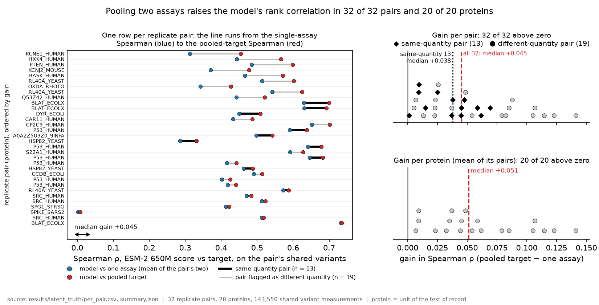
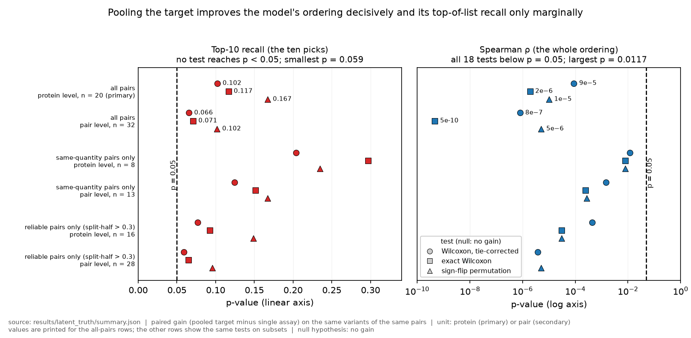
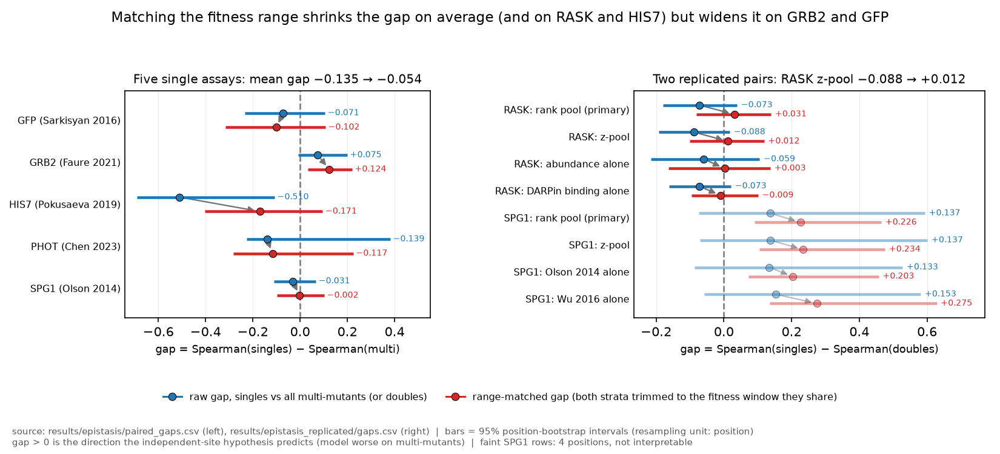
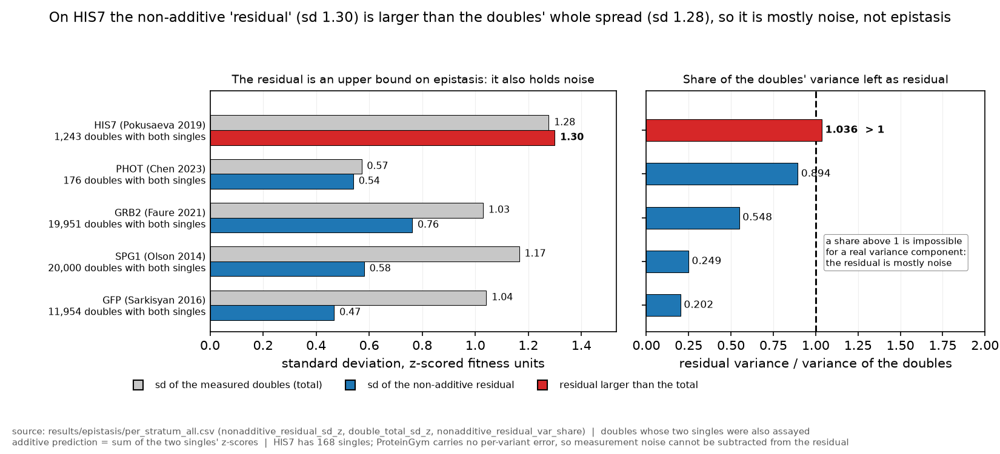
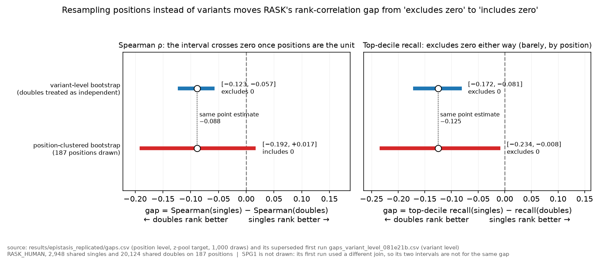
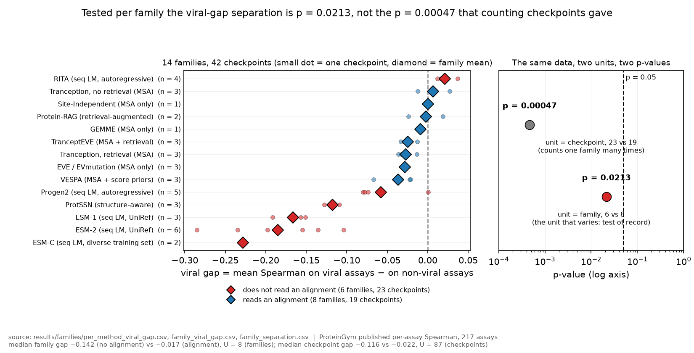
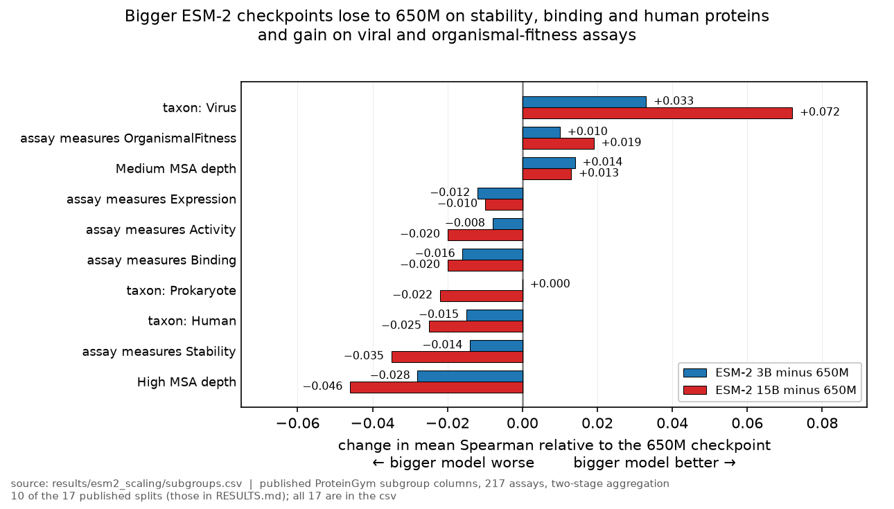

# Zero-shot variant effect prediction with ESM-2: good ranking, unreliable top ten

[](https://github.com/Qwuantabee/variant-effect-prediction/actions/workflows/tests.yml)
[](https://github.com/Qwuantabee/variant-effect-prediction/blob/main/LICENSE)
[](https://github.com/Qwuantabee/variant-effect-prediction/blob/main/pyproject.toml)

**Can a protein language model that has never seen a fitness measurement tell
which mutations break a protein, and which ten variants to build?** ESM-2 650M,
scored zero-shot on all 217 ProteinGym deep mutational scanning (DMS) assays,
ranks variants well; its top-ten picks beat random on average and are unreliable
on any one assay:

- **The ranking is real and reproduces the published benchmark**: headline
  Spearman 0.415 here against ProteinGym's 0.414, 214 of 217 assays within 0.01.
- **The top ten are much less reliable**: over 217 assays a mean 3.2 of the
  model's ten highest-ranked variants are in the measured top 10% (random scores
  0.9, BLOSUM62 1.7), but on 99 of the 217 it is two or fewer, a count random
  picking reaches or exceeds 26% of the time.
- **A cleaner measurement does not rescue them**: scored against the average of
  two assays of the same protein instead of one, top-10 recall does not rise
  significantly (p of at least 0.059 in all 18 tests, 20 proteins).
- **It fails on animal viruses**: mean Spearman 0.168 over 24 assays, where a
  plain per-column alignment model scores 0.408.

Terms: *Spearman* is the rank correlation between model score and measured
fitness over a whole assay; *top-10 recall* is the fraction of the model's ten
highest-ranked variants that are in the assay's measured top 10%; a *pooled
target* is the average of two assays of the same protein, a less noisy
measurement to score against (nothing is trained on it).

## At a glance


- **(a) A better target ranks better.** Pooling two assays of the same protein
  raises the model's Spearman in 32 of 32 replicate pairs (median +0.045) and in
  20 of 20 proteins (median +0.051). Most of this is arithmetic, not a property of
  the model: averaging two standardised assays raises *any* positively correlated
  predictor's correlation by 1/sqrt((1 + r_AB)/2) (exact for Pearson, approximate
  for Spearman), and that identity alone
  predicts a gain in 32 of 32 pairs and tracks the observed gains at r = 0.94.
  The 32 pairs are not 32 independent units either (20 proteins, 46 assays, P53
  alone in 6 pairs), and only 13 measure the same quantity twice.
- **(b) It does not pick the top ten better, not significantly.** Top-10 recall
  gains p = 0.0655 / 0.0710 / 0.102 (pair level) and 0.102 / 0.117 / 0.167
  (protein level, the primary test); none of the six crosses 0.05, nor does any
  of the 18 tests that also cover the same-quantity and reliable-pair subsets
  (smallest p = 0.059). The Spearman gain is p < 0.012 in all 18. The 18 are
  three tests x two levels x three nested subsets of the same pairs: correlated
  looks at one data set, with no multiple-testing correction. A correction can
  only raise the recall p-values, so the null reading does not depend on it.
- **(c) The model is not shown to match truth-vs-truth, or to fall short of it.**
  On 17 of 32 pairs its top-10 recall is below the agreement of the pair's two
  assays, on 14 above, on 1 level; the shortfall is not significant (p = 0.146 /
  0.152 / 0.073), so this data cannot separate the model from cross-assay
  agreement.
- **(d) Position clustering decides the RASK sign.** The singles-minus-doubles
  Spearman gap is −0.088 either way, but its interval is [−0.123, −0.057]
  (excludes zero) when the 20,124 doubles are resampled as independent variants
  and [−0.192, +0.017] (includes zero) when the 187 positions are resampled.

Three corrections to earlier versions of this README, each with its own figure
below: matching the
fitness range removes most of the singles-versus-multi gap (figure e); HIS7's
"epistatic" residual is larger than the doubles' own total variance, so it is mostly
noise (figure g); and the viral-gap family test is p = 0.0213, not the 0.00047 that
counting checkpoints gave (figure f).

## Limits that matter

- **Zero-shot means no fitness labels, not unseen proteins.** ESM-2 was trained on
  UniRef, which contains the wild-type sequences of the assayed proteins and
  their homologs.
- **DMS fitness is a lab proxy.** Growth, binding, fluorescence or abundance in a
  construct is not clinical pathogenicity; nothing here supports clinical use
  (see [docs/scope-and-open-items.md](docs/scope-and-open-items.md)).
- **Substitutions only.** No indels anywhere in the benchmark or the pipeline.
- **The replicate analysis is small and clustered.** 32 pairs from 20 proteins;
  19 of the 32 pair assays of *different* quantities, so their average is a
  pseudo-quantity. The protein-level tests are the primary ones for that reason.
- **Top-10 recall is a ten-variant metric.** It moves in steps of 0.1 per assay
  and is noisy at n = 9 or n = 20; "not significant" here is absence of evidence
  at this sample size, not evidence of no effect.
- **Groupings are the author's.** The same-quantity list, the 14 method families
  and the alignment / no-alignment split are hand-curated; the family test
  (p = 0.0213) rests on 6 against 8 families.
- **Published columns are quoted, not rerun.** The 3B/15B scaling and the
  97-method family comparison use ProteinGym's published per-assay table; only
  ESM-2 8M to 650M was run locally.
- **Licences.** Code MIT; ESM-2 weights MIT (Meta); ProteinGym MIT. No assay
  data or weights are redistributed here.

## What the model is worth against cheap alternatives

A correlation of 0.5 means nothing alone; the comparison that matters is against
methods that need no model. Mean Spearman over the 8 non-viral assays:

| method | mean Spearman | what it knows |
|---|---|---|
| **ESM-2 650M** | **0.562** | sequence context, learned from UniRef |
| BLOSUM62 | 0.242 | how often this swap appears in aligned homologs |
| hydropathy change | 0.152 | Kyte-Doolittle scale only |
| side-chain volume change | 0.123 | size only |
| proline/glycine heuristic | 0.108 | three structural rules of thumb |
| charge change | −0.003 | formal charge at pH 7 |
| random | −0.008 | nothing |


Context is worth roughly twice a position-blind substitution matrix: the part of
the signal that comes from knowing where in this protein the residue sits.
BLOSUM62's 0.242 is not nothing; read any new method at 0.3 against it.

## Detail, in figures

Each figure states one result; the text, derivations and per-assay tables are in `docs/`.
The benchmark, scaling and viral material is in [benchmark.md](docs/benchmark.md), the replicate and
epistasis analyses in [replicates-and-epistasis.md](docs/replicates-and-epistasis.md), and the scope
statements and open items in [scope-and-open-items.md](docs/scope-and-open-items.md).
The long generated tables are in [RESULTS.md](RESULTS.md).



[Detail](docs/replicates-and-epistasis.md#does-a-better-target-help-the-pooled-two-assay-test)



[Detail](docs/replicates-and-epistasis.md#does-a-better-target-help-the-pooled-two-assay-test)


[Detail](docs/replicates-and-epistasis.md#does-a-better-target-help-the-pooled-two-assay-test)



[Detail](docs/replicates-and-epistasis.md#epistasis-the-independent-site-score-is-not-worse-on-multi-mutants)



[Detail](docs/replicates-and-epistasis.md#epistasis-the-independent-site-score-is-not-worse-on-multi-mutants)



[Detail](docs/replicates-and-epistasis.md#the-same-question-on-a-pooled-two-assay-target)



[Detail](docs/benchmark.md#the-viral-split-is-not-an-esm-2-artefact)



[Detail](docs/benchmark.md#the-3b-question-a-trade-not-a-regression)

## Replicated epistasis

The table is rendered by `scripts/report_tables.py` from `results/epistasis_replicated/`; the
derivation and the verdict rules are in [docs/replicates-and-epistasis.md](docs/replicates-and-epistasis.md).

<!-- BEGIN GENERATED: epistasis_replicated -->
| protein | pair | parallel measures | why not | shared singles / doubles | exact-string join | canonical join |
|---|---|---|---|---|---|---|
| RASK_HUMAN | Weng_2022_abundance vs Weng_2022_binding-DARPin_K55 | NO | hand-curated DIFFERENT_QUANTITY list; reference coarse_selection_type differs: Expression vs Binding | 2,948 / 20,124 | 23,072 | 23,072 |
| SPG1_STRSG | Olson_2014 vs Wu_2016 | NO | different scale: lnW (Olson 2014) vs Fitness (Wu 2016) | 76 / 2,091 | 1,458 | 2,167 |

| protein | target | stratum | n | spearman [position CI] | top-decile recall |
|---|---|---|---|---|---|
| RASK_HUMAN | pooled_rank | singles | 2,948 | +0.449 [+0.382, +0.510] | 0.183 |
| RASK_HUMAN | pooled_rank | doubles | 20,124 | +0.521 [+0.415, +0.606] | 0.313 |
| RASK_HUMAN | pooled_z | singles | 2,948 | +0.453 [+0.383, +0.516] | 0.186 |
| RASK_HUMAN | pooled_z | doubles | 20,124 | +0.541 [+0.439, +0.622] | 0.312 |
| RASK_HUMAN | assay_a | singles | 2,948 | +0.177 [+0.083, +0.267] | 0.132 |
| RASK_HUMAN | assay_a | doubles | 20,124 | +0.236 [+0.053, +0.399] | 0.180 |
| RASK_HUMAN | assay_b | singles | 2,948 | +0.567 [+0.492, +0.635] | 0.176 |
| RASK_HUMAN | assay_b | doubles | 20,124 | +0.640 [+0.550, +0.718] | 0.316 |
| SPG1_STRSG | pooled_rank | singles | 76 | +0.551 [+0.116, +0.674] | 0.250 |
| SPG1_STRSG | pooled_rank | doubles | 2,091 | +0.414 [+0.081, +0.424] | 0.316 |
| SPG1_STRSG | pooled_z | singles | 76 | +0.551 [+0.116, +0.674] | 0.250 |
| SPG1_STRSG | pooled_z | doubles | 2,091 | +0.414 [+0.073, +0.421] | 0.311 |
| SPG1_STRSG | assay_a | singles | 76 | +0.545 [+0.116, +0.651] | 0.250 |
| SPG1_STRSG | assay_a | doubles | 2,091 | +0.411 [+0.123, +0.430] | 0.321 |
| SPG1_STRSG | assay_b | singles | 76 | +0.551 [+0.116, +0.674] | 0.250 |
| SPG1_STRSG | assay_b | doubles | 2,091 | +0.398 [+0.093, +0.417] | 0.292 |

| protein | stratum | n | spearman(A,B) | pearson(zA,zB) | Spearman-Brown (parallel pairs only) | corr(z-pool, A) | corr(z-pool, B) |
|---|---|---|---|---|---|---|---|
| RASK_HUMAN | all | 23,072 | 0.386 | 0.351 | n/a | 0.822 | 0.822 |
| RASK_HUMAN | singles | 2,948 | 0.478 | 0.367 | n/a | 0.852 | 0.800 |
| RASK_HUMAN | doubles | 20,124 | 0.348 | 0.324 | n/a | 0.814 | 0.814 |
| SPG1_STRSG | all | 2,167 | 0.906 | 0.758 | n/a | 0.937 | 0.937 |
| SPG1_STRSG | singles | 76 | 0.998 | 0.805 | n/a | 0.939 | 0.960 |
| SPG1_STRSG | doubles | 2,091 | 0.901 | 0.753 | n/a | 0.937 | 0.936 |

| protein | target | singles / doubles | positions | gap rho (single - double) | range-matched gap | top-decile gap |
|---|---|---|---|---|---|---|
| RASK_HUMAN | pooled_rank (primary) | 2,948 / 20,124 | 187 | -0.073 [-0.180, +0.039] | +0.031 [-0.082, +0.139] | -0.130 [-0.240, -0.007] |
| RASK_HUMAN | pooled_z | 2,948 / 20,124 | 187 | -0.088 [-0.192, +0.017] | +0.012 [-0.101, +0.119] | -0.125 [-0.234, -0.008] |
| RASK_HUMAN | assay_a | 2,948 / 20,124 | 187 | -0.059 [-0.216, +0.105] | +0.003 [-0.163, +0.137] | -0.048 [-0.142, +0.052] |
| RASK_HUMAN | assay_b | 2,948 / 20,124 | 187 | -0.073 [-0.161, +0.021] | -0.009 [-0.096, +0.101] | -0.140 [-0.273, -0.012] |
| SPG1_STRSG | pooled_rank (primary) | 76 / 2,091 | 4 | +0.137 [-0.075, +0.593] | +0.226 [+0.091, +0.465] | -0.066 [-0.369, +0.520] |
| SPG1_STRSG | pooled_z | 76 / 2,091 | 4 | +0.137 [-0.071, +0.601] | +0.234 [+0.105, +0.475] | -0.061 [-0.358, +0.462] |
| SPG1_STRSG | assay_a | 76 / 2,091 | 4 | +0.133 [-0.087, +0.528] | +0.203 [+0.073, +0.457] | -0.071 [-0.380, +0.462] |
| SPG1_STRSG | assay_b | 76 / 2,091 | 4 | +0.153 [-0.057, +0.581] | +0.275 [+0.135, +0.628] | -0.042 [-0.346, +0.549] |
<!-- END GENERATED: epistasis_replicated -->


## Usage

```python
from variant_effect import ESMScorer, data, evaluate

df, sequence = data.load_assay("BLAT_ECOLX_Stiffler_2015")
scorer = ESMScorer("facebook/esm2_t33_650M_UR50D")
scores = scorer.score_variants(sequence, df["mutant"].tolist())
print(evaluate.spearman(scores, df["DMS_score"].to_numpy()))
```

```
python scripts/run_benchmark.py --include-hard
python scripts/make_figures.py                  # all figures (the landscape needs the model)
python scripts/make_figures.py --only findings  # figures a-g and at-a-glance: committed results/ only
```

## Layout

```
src/variant_effect/
    mutations.py   parsing "A2M:K5R", validating against the sequence
    scoring.py     ESM-2 masked-marginals and wt-marginals, windowing for
                   proteins over 1022 residues
    baselines.py   BLOSUM62, hydropathy, volume, charge, Pro/Gly, random
    evaluate.py    Spearman with bootstrap CI, NDCG, top-k recall, AUC
    aggregate.py   ProteinGym's two-stage aggregation, validated against the
                   published subgroup table
    msa.py         .a2m parsing, sequence weights, site-independent scoring
    structure.py   AlphaFold models, all-atom SASA, buried vs exposed
    data.py        ProteinGym download and loading
scripts/
    run_benchmark.py          the 9-assay subset and the official comparison
    run_full_benchmark.py     all 217 assays, resumable, aggregated
    run_viral_alignment.py    alignment vs language model, split by host
    analyse_esm2_scaling.py   the 3B/15B pattern from the published table
    run_scaling_curve.py      the local 8M/35M/150M/650M curve
    run_structure_analysis.py burial splits and the burial-aware rescoring
    report_tables.py          regenerates the generated tables (README, RESULTS.md)
    make_figures.py           every figure; --only findings needs no model
    (plus the analysis scripts named in docs/; figures a-g read their results/)
RESULTS.md         the bulky generated tables the README refers to
docs/              the long-form sections moved out of this README
tests/             288 tests; the ones needing a GPU and a model download are
                   marked slow
```

## Setup

```
pip install -e ".[dev]"
pytest -m "not slow"        # 273 tests, no model needed
pytest -m slow              # downloads an 8M checkpoint AND ~1.6 GB of ProteinGym archives
```

`requirements.txt` pins the exact versions of the environment in which the suite passed
(Python 3.12.3, CPU torch).

**The assay data is not committed** (`data/` is git-ignored). The fetch has to name all 217
assays (about 1 GB extracted); a bare `data.ensure_assays()` extracts only the eight default
assays and leaves the nine data-reading tests failing:

```
python -c "from variant_effect import data; data.ensure_assays(list(data.reference_table()['DMS_id']))"
pytest                      # 288 passed, with the data
VE_ALLOW_MISSING_DATA=1 pytest -m "not slow"    # 265 passed, 8 skipped, no data/
```

Download sizes, the escape's semantics and two environment notes (`HF_HUB_OFFLINE`,
`pip_system_certs`) are in [docs/setup-notes.md](docs/setup-notes.md).
