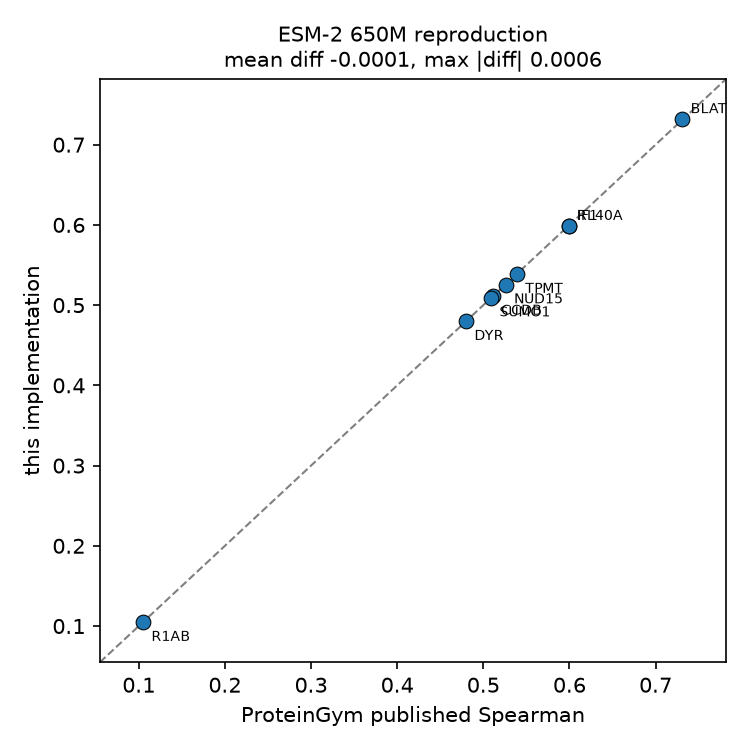
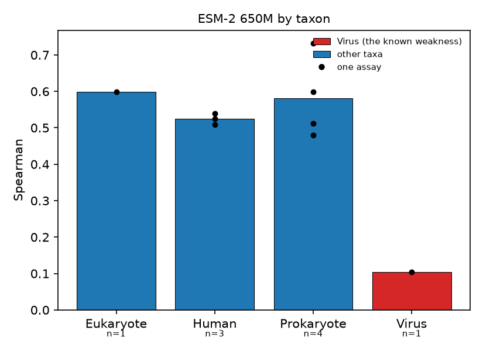
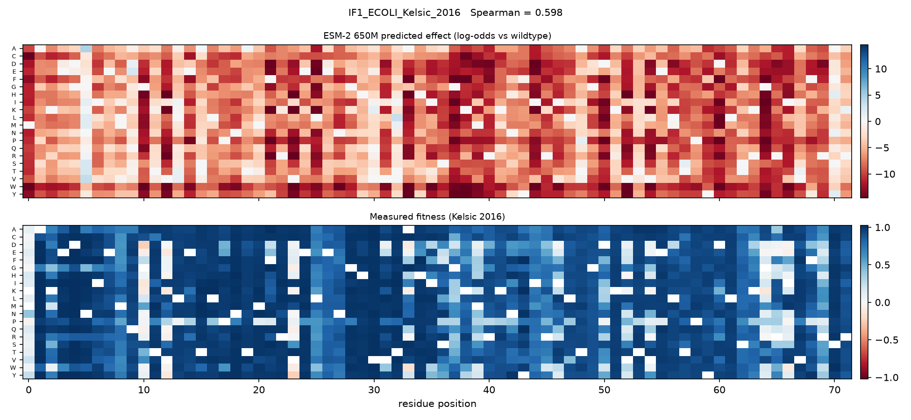
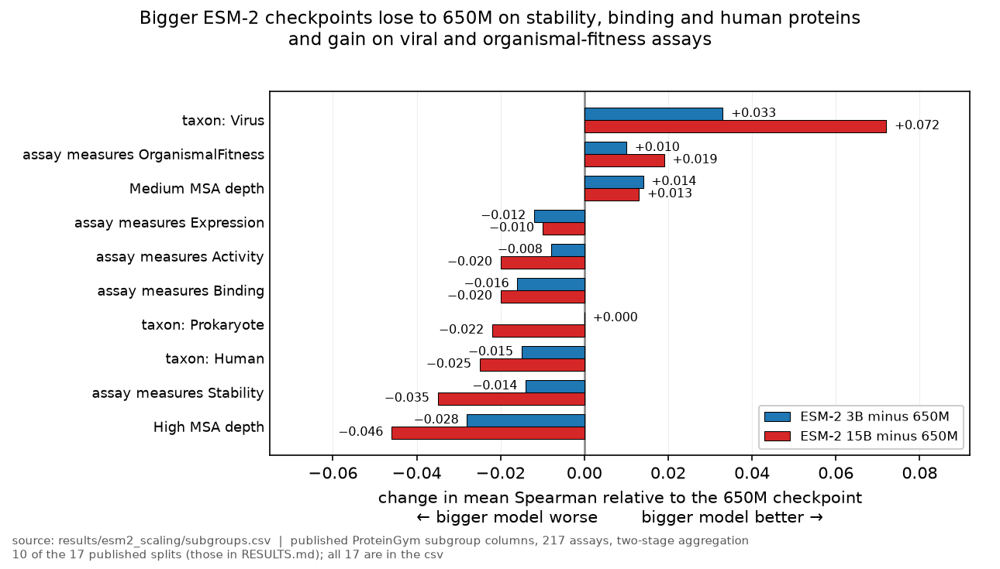
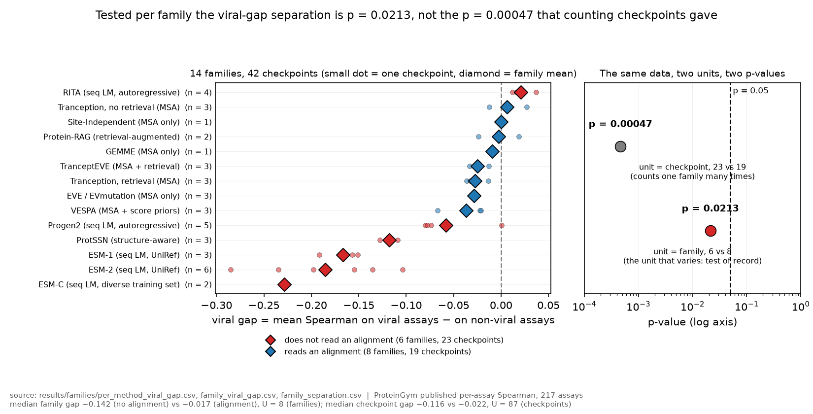

# Benchmark, scaling and viral failure: the long form

Moved out of the README without edits to the text. The summary and the figures are in the [README](../README.md).

## Does the implementation actually work

A pipeline that is off by one still produces plausible correlations, so the
check is against the reference: ProteinGym publishes per-assay Spearman for ~97
predictors.

| assay | this implementation | ProteinGym published | difference |
|---|---|---|---|
| IF1_ECOLI_Kelsic_2016 | 0.598 | 0.599 | −0.001 |
| CCDB_ECOLI_Tripathi_2016 | 0.511 | 0.511 | 0.000 |
| SUMO1_HUMAN_Weile_2017 | 0.509 | 0.509 | 0.000 |
| RL40A_YEAST_Roscoe_2013 | 0.598 | 0.599 | −0.001 |
| DYR_ECOLI_Thompson_2019 | 0.480 | 0.480 | 0.000 |
| NUD15_HUMAN_Suiter_2020 | 0.526 | 0.526 | 0.000 |
| TPMT_HUMAN_Matreyek_2018 | 0.539 | 0.539 | 0.000 |
| BLAT_ECOLX_Stiffler_2015 | 0.732 | 0.731 | +0.001 |
| R1AB_SARS2_Flynn_2022 | 0.105 | 0.105 | 0.000 |

Mean difference −0.0001, maximum absolute difference 0.0006; the residual is
rounding in the published table.



One real bug had to be fixed on the way: rows were built as
`{"assay": dms_id, **metadata}` and the metadata had its own `assay` key, which silently
replaced the DMS id, so every lookup against the official table missed and the
comparison printed an empty table instead of failing
(`test_metadata_does_not_collide_with_result_columns`).

## The caveat that matters for actually using it

Spearman is computed over the whole assay, mostly variants that are obviously
fine or obviously dead. For choosing a handful of variants to build, the
question is how many of the model's top picks are genuinely good. Top-10 recall
(the fraction of the model's 10 highest-ranked variants that are truly in the
assay's top 10%) across the nine assays: 0.0, 0.1, 0.1, 0.2, 0.2, 0.2, 0.2, 0.6,
0.9; random scores 0.1. On three of nine the top 10 picks are at or below the
random rate and on seven of nine they hold at most two true top-decile variants,
a count random picking reaches or exceeds 26% of the time (binomial, n = 10,
p = 0.1), despite a respectable Spearman. (An earlier version said "five of nine"; the committed
recalls give three or seven depending on the cut, never five.) Nine assays are a
small sample: over all 217 (`results/full/esm2_t33_650M_UR50D_per_assay.csv`) the
model's mean top-10 recall is 0.323 against 0.095 for random scores and 0.168 for
BLOSUM62, and it is 0.2 or lower on 99 of them, so the top ten beat random on
average and cannot be relied on for any one assay. The model separates
dead variants from
live ones and ranks poorly within the live ones, which is the regime an
engineering campaign cares about. The sections below ask why.

## Where it fails, and why that is predictable



The SARS-CoV-2 assay scores 0.105 against 0.56 for everything else, and BLOSUM62
beats ESM-2 on it (0.207 vs 0.105). Not a bad draw: ESM-2's published average on
viral proteins across the benchmark is 0.261 against 0.457 on human proteins. The
model learns constraint from conservation across UniRef, which assumes residues
are conserved because the protein needs them; viral proteins are also under
immune selection, so positions vary across strains for reasons unrelated to
folding, and the model reads that variation as tolerance. For viral targets use a
method built on an alignment of the specific family.

## The mutational landscape



Predicted effect of all 20 amino acids at every position of E. coli IF1, above
the measured fitness from the same assay. The model has seen no experimental
data; the vertical dark stripes are positions that tolerate nothing, and they
line up with the measured ones at Spearman 0.598.

## The full benchmark, and the aggregation nobody mentions

The nine-assay subset is eight small single-mutant assays plus one viral
failure; its mean Spearman (0.562 over the eight non-viral assays, 0.511 over all
nine) is not comparable to any published number. All
217 assays:

<!-- BEGIN GENERATED: full_benchmark -->
|  | this implementation | ProteinGym published | difference |
|---|---|---|---|
| headline (macro over 5 categories) | +0.415 | +0.414 | +0.001 |
| per-assay mean (unbalanced) | +0.439 | +0.438 | +0.001 |
<!-- END GENERATED: full_benchmark -->

<!-- BEGIN GENERATED: full_benchmark_coverage -->
217 of 217 assays scored. Against the published per-assay column: mean difference +0.0009, median absolute 0.0003, maximum absolute 0.2307. 214 of 217 assays within 0.01.
<!-- END GENERATED: full_benchmark_coverage -->

The headline is not the mean of the per-assay values: ProteinGym's 0.414 for
ESM-2 650M sits 0.024 *below* the plain mean of its own per-assay column. The
two-stage rule (average per UniProt id within a group, then the five functional
categories with equal weight; derivation in the `run_full_benchmark.py` docstring)
reproduces all twelve published subgroup columns to within 0.0005 and every
published headline from 8M to 15B (`tests/test_aggregate.py`). The published numbers
are over **all** mutants, not single substitutions: on A4_HUMAN_Seuma_2022 scoring
everything gives 0.431 against a published 0.431, singles only 0.498, which would
have put 20 of the 217 assays off by up to 0.10.

## Why the viral failure happens, tested rather than asserted

The immune-selection explanation predicts that a method reading conservation off
an alignment *of that viral family* should do well on the same assays, because
immune-driven variation is sparse within a family even when common between them.
I implemented the site-independent model (Hopf et al. 2017: per-column amino acid
frequencies from the assay's own MSA, scored as
`log f(mut|position) − log f(wt|position)`), the weakest thing that qualifies as
alignment-based, so a conservative test.

<!-- BEGIN GENERATED: viral_comparison -->
| group | assays | alignment (ours) | alignment (published) | ESM-2 650M (published) | alignment beats ESM-2 |
|---|---|---|---|---|---|
| animal viruses | 24 | +0.408 | +0.398 | +0.168 | 21/24 |
| bacteriophages | 7 | +0.328 | +0.268 | +0.615 | 1/7 |
| all viral assays | 31 | +0.390 | +0.369 | +0.269 | 22/31 |
<!-- END GENERATED: viral_comparison -->

Over all 31 viral assays the two methods are close, and that average hides
opposite effects: the alignment wins 21 of 24 animal-virus assays and loses 6 of
7 bacteriophage assays. That is what the immune-selection story predicts, and the
phage row is what makes it a test rather than a fit: a phage replicates in a
bacterium, which has no adaptive immune system, so there is no immune selection
to confuse a model, and the language model wins there, as it should.

Two implementation traps produced plausible numbers while wrong (the `.a2m` query
row is a subsequence of the target on 20 of the 31 viral assays, and aligning it first
took the viral mean from 0.16 to 0.39; the first N rows of a score-sorted alignment are
one clade, not a sample); both are in the `run_viral_alignment.py` docstring. Even then
the method underperforms on the smallest proteins (alignments of 40-60 residues):
VG08_BPP22 and VRPI_BPT7 both go the wrong way.

## The 3B question: a trade, not a regression

Published headline: 0.414 at 650M, 0.406 at 3B, 0.400 at 15B. The 3B checkpoint
(~12 GB) was not downloaded, so local measurements stop at 650M; local and
published numbers are kept apart.

**Local, nine assays, four checkpoints** (`scripts/run_scaling_curve.py`):

<!-- BEGIN GENERATED: scaling_local -->
| model | assays | mean Spearman | sd |
|---|---|---|---|
| 8M | 9 | 0.179 | 0.147 |
| 35M | 9 | 0.348 | 0.213 |
| 150M | 9 | 0.474 | 0.161 |
| 650M | 9 | 0.511 | 0.170 |
<!-- END GENERATED: scaling_local -->

Each step is real (paired differences significant at every step) but the third
buys a quarter of what the first did: by 650M the curve is near its plateau.

**Published.**

<!-- BEGIN GENERATED: scaling_headline -->
| model | params | headline | published_se |
|---|---|---|---|
| ESM2 (8M) | 8M | 0.226 | 0.015 |
| ESM2 (35M) | 35M | 0.321 | 0.015 |
| ESM2 (150M) | 150M | 0.387 | 0.013 |
| ESM2 (650M) | 650M | 0.414 | 0.012 |
| ESM2 (3B) | 3B | 0.406 | 0.011 |
| ESM2 (15B) | 15B | 0.400 | 0.010 |
<!-- END GENERATED: scaling_headline -->

The 0.008 gap sits inside the published bootstrap standard errors (~0.012), so an
unpaired reading cannot call it real; a *paired* test over the 217 assays can,
because it removes between-assay difficulty, which dominates those SEs: 3B − 650M is
−0.0061 (Wilcoxon p = 0.0223, 96 wins against 118 losses) and 15B − 650M −0.0130
(p = 0.0198), against +0.0377 for 650M − 150M (p < 0.0001); the full table is in
[RESULTS.md](../RESULTS.md#esm-2-scaling-published). 3B is slightly but consistently
worse on the average assay, and not uniformly:



*Figure h. Change in mean Spearman from 650M to 3B (blue) and to 15B (red) by what
the assay measures (published ProteinGym subgroup columns). Stability, binding,
activity, expression and human-protein assays get worse; viral (+0.033 at 3B,
+0.072 at 15B), organismal-fitness and medium-MSA-depth assays get better.*

The split is by what each assay measures: an objective mismatch, not a scaling
failure (reasoning in the `analyse_esm2_scaling.py` docstring). 650M is the right default
for stability and binding work; for a virus neither 650M nor 3B is the right tool, the
alignment method is.

## The top-k problem is not about burial

Why are the model's top 10 picks indistinguishable from random on seven of nine
assays?
The natural suspicion is burial: nearly any substitution at a buried residue is
damaging, so ranking among those variants is compressed, while an exposed residue
spans a wider range. ProteinGym distributes AlphaFold2 models for all 217 assays,
so it is testable: `src/variant_effect/structure.py` computes per-residue relative
solvent accessibility (all-atom Shrake-Rupley against Tien et al. theoretical
maxima) and `scripts/run_structure_analysis.py` splits each assay's variants into
buried, intermediate and exposed. **The hypothesis is wrong, and in the opposite
direction.**

<!-- BEGIN GENERATED: structure_burial -->
| buried/exposed | n | Spearman | top-10 recall |
|---|---|---|---|
| buried | 3605 | +0.417 | +0.800 |
| intermediate | 3235 | +0.317 | +0.300 |
| exposed | 4167 | +0.282 | +0.100 |
<!-- END GENERATED: structure_burial -->

Spearman is *highest* at buried positions and lowest at exposed ones, and
BLOSUM62 shows the same ordering, so it is a property of the assays, not the
model: a compressed fitness range does not degrade a rank correlation computed
within that range, and at buried positions almost every substitution is damaging,
so calling them all bad is mostly right. The model's top-10 picks are *not*
biased toward exposed positions (mean relative accessibility of the top picks is
within 0.011 of the assay mean, no significant departure from zero), so there is
no shortcut to correct. The constructive test (penalise buried substitutions, fit
on half the assays, evaluate on the other half) was not completed: the held-out
set is too small in the runs that finished to call it either way, so no number
is quoted here and there is no artefact for it.

The candidates left: measurement noise, a better target, and epistasis (next).


## Masked marginals vs the cheap alternative

Scoring uses masked marginals, the scheme from the ESM paper: mask the mutated
position, take the log-softmax over the vocabulary, and score the variant as

```
log p(mutant | context) − log p(wildtype | context)
```

The alternative is one forward pass over the unmutated sequence ("wt-marginals").
On IF1_ECOLI with ESM-2 8M, wt-marginals actually scored slightly *higher* (0.217
vs 0.193); that inversion does not hold at 650M, where masking is clearly better,
but the expensive scheme is not automatically right at every model size. Masking
only positions that appear in the assay gives identical results and is the
difference between seconds and minutes: all 25,501 variants across nine assays
scored in 22 seconds on an RTX 5070 Ti.


## The viral split is not an ESM-2 artefact

The viral failure was explained above as an objective mismatch, but that rested on
one model family. It predicts that a different architecture trained on different
data should fail the same way, and that a method reading an alignment of the
assayed family should not. ProteinGym publishes per-assay Spearman for 97 methods
on the same 217 assays, so this is testable without running anything:
`scripts/run_family_analysis.py` takes the virus mean minus the non-virus mean for
each method and groups the result by what the method is trained to do (per-family
table: [RESULTS.md](../RESULTS.md#viral-gap-by-method-family)).



*Figure f. Viral gap (mean Spearman on viral assays minus on non-viral assays) for
the 42 checkpoints of 14 method families: small dots are checkpoints, diamonds are
family means. The 6 families that do not read an alignment (red) have a median
viral gap of −0.142 and the 8 that do (blue) −0.017. Tested per family, the unit
that varies, the exact one-sided Mann-Whitney test gives U = 8, p = 0.0213; counting
the 23 and 19 checkpoints as independent gives p = 0.00047, which counts one family
many times and is not the evidence.*

<!-- BEGIN GENERATED: family_separation -->
Tested at the level of the family, which is the unit that varies (checkpoints within a family share an architecture and a training set): the 6 families that do not read an alignment have a median viral gap of -0.142, the 8 that do have -0.017; the exact one-sided Mann-Whitney test gives U = 8, p = 0.021. Counted per checkpoint (23 versus 19) the same test returns p = 0.00047, but that number counts one family many times and is shown only so it is not mistaken for the evidence.
<!-- END GENERATED: family_separation -->

ESM-C, a different architecture and training set, fails harder rather than differently
(0.238 on virus against 0.465 elsewhere, a gap of −0.227 where ESM-2 650M's is −0.198, at
300M and 600M alike). The retrieval-augmented methods (AIDO Protein-RAG 16B −0.024;
Protriever +0.018 over the 200 assays where it is reported) have nearly closed a gap that
costs ESM-2 650M 0.198 of its 0.466 non-viral per-assay mean, about 42% of it. (An
earlier version said 48%, dividing by the 0.414 headline. That headline is a two-stage
aggregate over all 217 assays, viral ones included, not a non-viral mean; 650M's own
non-viral per-assay mean in `results/families/per_method_viral_gap.csv` is 0.4665, the
column the gap itself is computed on.) The one row that does not fit is RITA (+0.021), also
the lowest-scoring sequence-only family on non-viral assays (0.355), so its flatness is more
likely a ceiling effect than a viral strength; it is reported rather than trimmed, because
trimming one inconvenient family is how a trend becomes a story. Per-assay means against
headlines (the retrieval figures usually quoted are per-assay means, about 0.03 above the
published headlines) and the rest of this discussion are in the `run_family_analysis.py` docstring.

<!-- BEGIN GENERATED: quoted_headlines -->
ProteinGym headlines, read from the published summary table: ESM2 (650M) 0.414, ESM-C (300M) 0.406, ESM-C (600M) 0.405, AIDO Protein-RAG (16B) 0.518, Protriever 0.479.
<!-- END GENERATED: quoted_headlines -->

Those are the two-stage headlines a reader will find in the paper; the plain per-assay means are higher (0.438 for ESM-2 650M), and quoting one against the other is the mistake the aggregation section warns about, so the gap table uses the per-assay column for every method identically.
