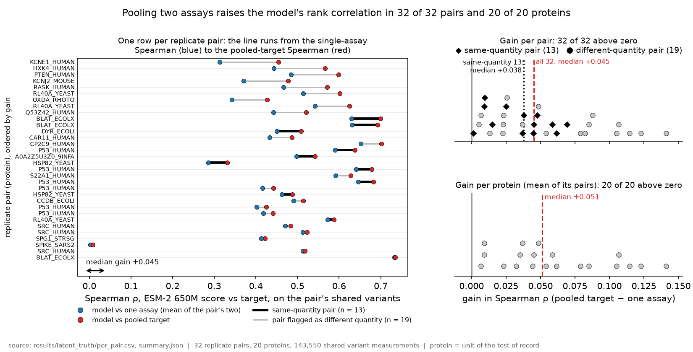
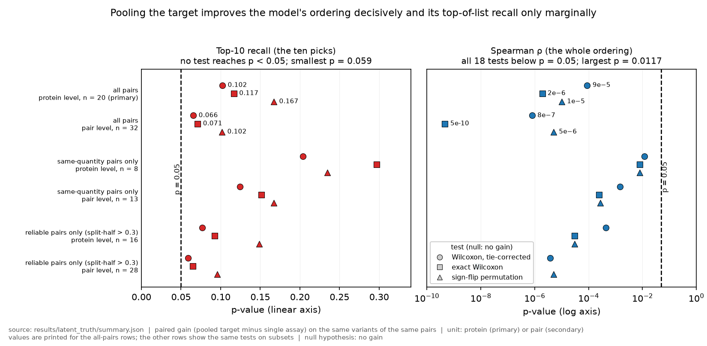
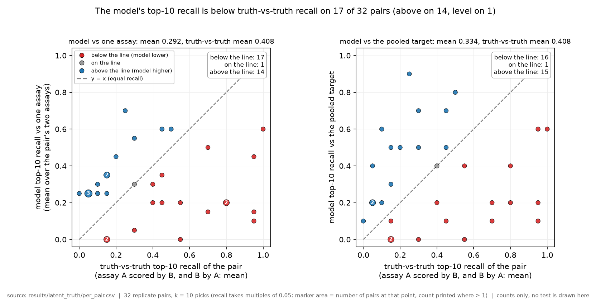
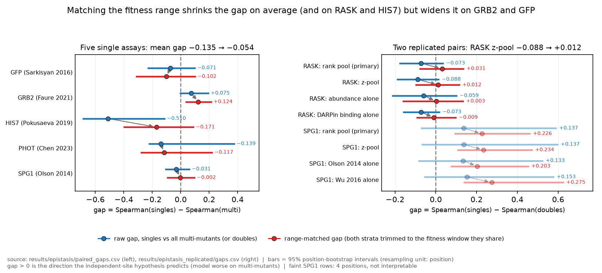
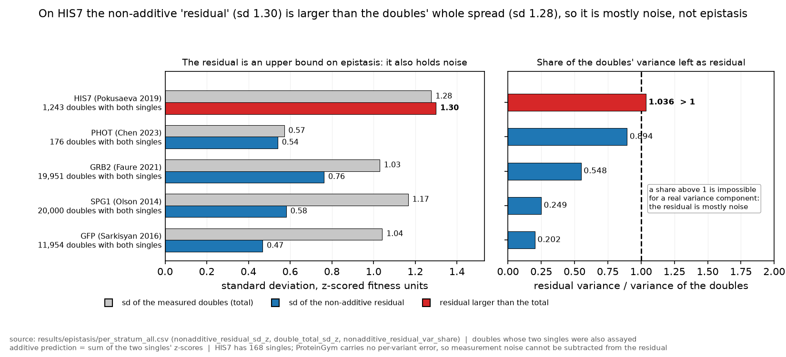
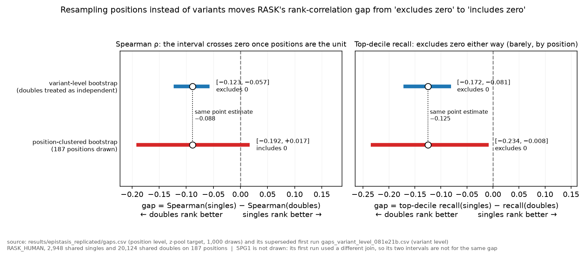

# Replicate assays, pooled targets and epistasis: the long form

Moved out of the README without edits to the text, except that the replicated-epistasis table kept in the README is not repeated here. Summary and figures: [README](../README.md).

## What replicate assays say: 0.350 is agreement, not a ceiling

`scripts/run_topk_analysis.py` uses the 37 pairs of same-protein assays in ProteinGym
(22 proteins with two or more assays, restricted to the variants each pair shares,
at least 200 of them) as replicate measurements; the full table is in
[RESULTS.md](../RESULTS.md#replicate-assay-agreement-and-decile-shape). The median
top-10 recall of one assay against its replicate is 0.350, the median Spearman
over the whole shared set 0.610, the median Jaccard overlap of the two top deciles
0.161, and the model's own mean top-10 recall 0.323 over 217 assays, 0.329 over the
51 assays in those 37 pairs and 0.326 over the 46 assays in the 32 pairs with at
least 1,000 shared variants (the set the pooled test below uses).

**What 0.350 is, and what it is not.** It is how well one assay agrees with
another on which variants are in the top 10%. It is *not* an information-theoretic
upper bound, and the earlier version of this paragraph was wrong to call it a
ceiling: two assays of one protein are two *noisy* measurements of the same latent
quantity, their agreement is attenuated by both errors, and a predictor that
tracked the latent quantity closely could beat their mutual agreement without
contradicting anything. Two further problems with the original sentence are fixed
here. 0.350 was a median over 37 replicate pairs and 0.323 a mean over a different
population, 217 assays; those are not comparable, hence the 0.329 over the 51
assays in the 37 pairs. And the honest question is not "is the model near
0.35" but "does the model's recall rise when the target gets closer to the
truth". Inside one assay's top decile the measurement error (median 0.592 sd
units) is larger than the first assay's decile spread (median sd 0.294; the second
assay's is 0.235); on 29 of 37 pairs the
decile's range is smaller than one measurement's error. That says the decile is
hard to resolve, not that it cannot be ranked (the simulated control in the
`run_topk_analysis.py` docstring shows why).

The heterogeneity candidate does not survive: decile shape (spread ratio, range
share, distinct fraction, share at the maximum) predicts the model's recall over
the 217 assays with |Spearman| at most 0.122, none a predictor worth acting on
(RESULTS.md).

## Does a better target help? The pooled two-assay test

Averaging two replicate measurements reduces the noise, so the average is a better
target than either assay. `scripts/run_latent_truth_test.py` builds it for every pair with at
least 1,000 shared variants (32 pairs, 20 proteins, 143,550 shared variant
measurements) and scores the model against the single assays and the pooled estimate
on the same variants, with a paired test. Every number is in
[RESULTS.md](../RESULTS.md#pooled-two-assay-target).

*Figure a. Spearman(model, pooled target) minus Spearman(model, one assay), per
replicate pair (left; heavy rows are the 13 same-quantity pairs) and as a
distribution per pair and per protein (right). All 32 pairs and all 20 proteins go
up: median +0.045 per pair, +0.051 per protein, +0.038 over the 13 same-quantity
pairs (p < 0.0001 by all three methods at both levels).*

*Figure b. The same comparison as p-values: three tests, pair or protein level, all /
same-quantity / reliable pairs. No top-10 recall test reaches 0.05 (smallest 0.059);
every Spearman test is below 0.012. The six primary recall tests are 0.102 / 0.117 /
0.167 (protein level, the primary test because the 32 pairs share proteins and assays;
P53 alone contributes 6 pairs, and 14 of the 46 assays sit in more than one pair) and
0.0655 / 0.0710 / 0.102 (pair level); which one lies nearest 0.05 is not evidence for
anything. At the protein level 12 of 20 proteins gain top-10 recall, 4 lose, 4 tie
(pair level 16, 9, 7); the median is 0.250 against the pool and against one assay.*

*Figure c. One point per pair: truth-vs-truth top-10 recall (x) against the model's
(y). Truth against truth is a mean 0.408 on these pairs and the model against one
assay 0.292. The model is below the line on 17 of 32 pairs, above on 14, level on 1
(16 / 15 / 1 against the pooled target). The shortfall is not significant: p = 0.146 /
0.152 / 0.073 over pairs (tie-corrected Wilcoxon / exact / sign-flip permutation) and,
over the 20 proteins, a mean gap of 0.124 with p = 0.153 / 0.169 / 0.111.*

Against a less noisy truth the model ranks consistently better, and its ten picks do
not consistently land better. The old truth-vs-truth comparison does not survive
either: on 32 pairs with a ten-variant metric this data cannot separate the model from
cross-assay agreement, and it cannot show that the cross-assay number was never an
upper bound (the +0.475 control below is self-inclusion, so that point rests on the
attenuation argument alone).

**Correction kept on purpose: the float-tie p-values.** An earlier version of this
README quoted p = 0.063 for the pair level and a reviewer reproduced 0.049: both are
artefacts. Recall differences are multiples of 0.05 computed by float subtraction, and
the 17th digit decided which tied differences received which rank (15 distinct values
where 6 exist), so the unrounded Wilcoxon p moves between roughly 0.049 and 0.065 with
the scipy version and the order the floats were produced in. The differences are now
rounded to nine decimals before any rank is taken.

**Read the 32 of 32 as evidence about attenuation, not as headroom.** The Spearman gain
is *anti*-correlated with split-half reliability across pairs (Spearman −0.84,
p < 0.0001): the pairs that gain most are the ones whose two assays agree least, where
averaging two measurements mostly averages two disagreements. The recall gain shows no
such pattern (Spearman −0.07, p = 0.71), and is the same +0.025 median on the 28
reliable pairs as on all 32: on the metric this README leads with, a better target
barely moves the model.

**The +0.475 is self-inclusion, not a measurement of attenuation.** Scored against the
pooled target instead of one assay, an assay gains a median +0.475 top-10 recall on the
same pairs (Wilcoxon p < 0.0001), but the assay is half of the target it is scored
against, so its own noise counts as signal. The simulated control
(`scripts/sim_pooling_controls.py`, 400 simulations of 2,000 variants, seed 0): with two
assays that share *no* signal, A-versus-B recall is 0.109 and A-versus-pool recall
0.855, a gain of +0.746 from nothing; at the real median noise level the same assay
gains +0.234 (0.764 to 0.998). So this control does not demonstrate that 0.350 cannot
be an upper bound, and the earlier sentence that said it did is withdrawn. The argument
that 0.350 is not a bound on a predictor (agreement between two noisy readings is
attenuated by both errors) stands as reasoning; these data do not measure by how much.

**So what is the ceiling?** There is no measured upper bound here and the data cannot
supply one, since that needs the latent truth, which is what a noisy assay fails to
give. What survives is narrower: ordering *inside* a top decile is hard to resolve
when measurement error exceeds the decile's spread, a statement about resolvability and
not about the model's headroom. What the pooled target is and is not (shared error
survives averaging; a different-quantity pair's average is a pseudo-quantity) is in the
`run_latent_truth_test.py` docstring.

## Epistasis: the independent-site score is not worse on multi-mutants

What is left is epistasis, and this data *can* test it
(`scripts/run_epistasis_test.py`; table in [RESULTS.md](../RESULTS.md#epistasis-five-assays)). The
result does **not** support the independent-site explanation: the degradation it
predicts is absent, and in point estimate the ranking is *better* on multi-mutants
(+0.481 mean Spearman against +0.346 on single mutants; top-decile recall 0.294 against
0.213; 60,277 multi-mutant rows against 5,453 single-mutant rows). That is not a
refutation: with five assays the mean gap of −0.135 Spearman is far from significant
(paired t = −1.36, p = 0.25; top-decile recall −0.081, t = −1.24, p = 0.28), a sample
too small to exclude a modest degradation. Every interval is a position bootstrap
(variants cluster by position): only HIS7's gap (−0.510 [−0.691, −0.109], 170
positions) excludes zero on the favourable side; GFP, PHOT and SPG1 span zero, and so
does GRB2, which goes the other way by +0.075 [−0.008, +0.199]. (An earlier version said
three of four intervals excluded zero favourably and that GRB2's was the only one
excluding it against the hypothesis; those came from a variant-level bootstrap, too
narrow for clustered variants.) The earlier version also said the data could not test
this because 47 of the 51 assays behind the replicate pairs contain no multi-mutants:
true of the replicate subset, false of the dataset, where 69 of the 217 assays contain
multi-mutants and 65 have at least 100 singles alongside at least 100 multi-mutants
(over 1.77 million multi-mutant rows).

**Two confounds could manufacture a multi-mutant advantage; both were tested.** *Fitness
range:* a combinatorial library has a long deleterious tail that a single-substitution
library does not, and a rank correlation over a wider spread is mechanically easier, so
both strata were trimmed to the intersection of their central 90% of measured fitness
(figure e). The mean gap shrinks from −0.135 to −0.054 and still points away from the
hypothesis, but GRB2's range-matched gap is **+0.124 [+0.032, +0.219]**: in the direction
of degradation, interval excluding zero, where the raw gap's did not. One assay of five,
no correction for five looks, so it is reported rather than weighted. *Position
coverage:* PHOT's multi-mutants touch 15 positions while its 2,122 singles span 118;
restricting the singles to those positions binds **only for PHOT** (276 singles remain;
for the other four assays every single already sits on a multi-mutant position, so the
control is a no-op), and PHOT's multi-mutants still win by −0.435 (position-matched
singles rho = +0.353 against +0.788).

*Figure e. Raw (blue) and range-matched (red) gap, Spearman(singles) minus
Spearman(multi-mutants), with position-bootstrap 95% intervals. Left: the five assays
above. Right: the two replicated pairs of the next section. Matching the fitness range
shrinks the five-assay mean gap from −0.135 to −0.054 and RASK's z-pool gap from −0.088 to
+0.012, and widens GRB2 (+0.075 to +0.124) and GFP (−0.071 to −0.102). SPG1 (right) has 4
positions and is not interpretable.*

**The mechanism is not the one independence predicts.** If the model were wrong in
proportion to the number of independent sites it summed, rho would fall as the number of
substitutions k rises. On PHOT it is +0.724 at k = 2 and still +0.682 at k = 14; on HIS7 it
*rises* from +0.157 to +0.732 (k = 2 to 12). A multi-mutant accumulates damages, so it is
easier to identify as broken, the same easiness the burial analysis found: independent
summation succeeds because the task at the top of a DMS assay is detecting damage, not
predicting fitness. Per-assay intervals, the 5+ stratum and the singles-versus-doubles gaps
are in the `run_epistasis_test.py` docstring.

**Epistasis itself is present and large; that is a separate, model-free question.** For
every double whose two singles were also assayed, the additive prediction is the sum of
the singles' z-scored fitness and the *non-additive residual* is what is left against the
measured double. It is an **upper bound** on epistasis, not the epistatic term: it also
contains the measurement noise of the double and of both singles, and ProteinGym carries
no per-variant error to subtract. It carries a mean 0.586 of the doubles' variance across
the five assays: 0.20 for GFP, 0.25 for SPG1, 0.55 for GRB2, 0.89 for PHOT, 1.04 for HIS7.

*Figure g. Left: standard deviation of the measured doubles (grey) and of the non-additive
residual (blue; red where the residual is the larger). Right: the residual's share of the
doubles' variance. HIS7's is 1.036, and a share above 1 is impossible for a real variance
component: for HIS7 (168 singles, truth sd 0.192, model rho +0.028) measurement noise in
the singles dominates the residual, and the run flags it (`residual_exceeds_total`).*

Singles predict doubles at rho = +0.656 on average, so non-additivity is present, to an
extent this measurement can only bound from above, and the model's top decile is not
demonstrably mediocre because of it. **Limits:** all five are ProteinGym substitution assays
with one readout per variant, but the reference table records one selection type per
assay, not per library, so that a singles library and a combinatorial library were scored
for the same quantity is assumed, not verified; CAPSD_AAV2S_Sinai_2021 (41,796
multi-mutants over a 735-residue protein) was left out on CPU cost, so the largest viral
library is not represented. Reporting a top-k recall without the assay's own replicate
agreement (a median 0.350 across the 37 pairs: agreement between two noisy readings, not
an upper bound) can make a model look worse than it is.

## The same question on a pooled two-assay target

The five assays above have a confound: the singles and the combinatorial library are
*different variant sets*, measured as separate experiments, so a rank difference
between strata can be a difference in the target, not the model.
`scripts/run_epistasis_replicated.py` removes it for two proteins. Two assays of the *same
protein* are intersected on the **canonical** variant string (substitutions sorted by
position; an exact-string join drops every double the two labs wrote in opposite
orders, which cost SPG1 709 doubles), and the same independent-site scorer ranks the
shared singles and doubles against four targets reported side by side: assay A, assay
B, the z-pool and the rank pool. The rank pool is the designated primary (no
affine-scale assumption); it was fixed before the run.

**Neither pair is a replicate pair**, and an earlier version was wrong to call them two
independent experiments of one quantity. RASK_HUMAN (Weng 2022, abundance vs binding to
DARPin K55) is on the repo's different-quantity list (reference table: Expression vs
Binding), so Spearman-Brown is withheld and the pooled target is a pseudo-quantity.
SPG1_STRSG (Olson 2014 vs Wu 2016) is the same biology on monotone but not affinely
related scales, so a z-pool averages unlike scales. RASK shares 20,124 doubles and 2,948
singles, SPG1 2,091 doubles and 76 singles (join counts, the scale check and the skipped
third protein are in the `run_epistasis_replicated.py` docstring).
**Every interval is a position bootstrap** (positions drawn with replacement, variants
weighted by the product of their positions' multiplicities, one draw shared by both
strata): RASK's 20,124 doubles sit on 187 positions, so an interval that resamples
variants is about three times too narrow.

*Figure d. The same RASK_HUMAN gap (singles minus doubles, z-pool target) under two
resampling units. Left, Spearman: −0.088 either way, but [−0.123, −0.057] when the
20,124 doubles are resampled as independent variants (what the earlier README quoted)
and [−0.192, +0.017] when the 187 positions are: the first excludes zero on the side
opposite the hypothesis, the second includes it and is about three times wider (0.209
against 0.066). Right, top-decile recall: −0.125 either way, [−0.172, −0.081] by
variant and [−0.234, −0.008] by position, which only barely excludes zero. The
variant-level numbers are the superseded first run, kept as
`results/epistasis_replicated/gaps_variant_level_081e21b.csv` and reproduced from the
committed scored frame by `tests/test_figures.py`. SPG1 is not drawn: its first run
used a different join, so the two intervals would not be for the same gap.*

The four replicated-epistasis tables (generated; a test pins them to the renderer)

(The replicated-epistasis table, generated, is in the README under "Replicated epistasis".)

**RASK_HUMAN: no degradation is distinguishable.** Against the rank pool the doubles rank
better than the singles in point estimate (Spearman +0.521 against +0.449); the
singles-minus-doubles gap is −0.073 [−0.180, +0.039], which includes zero (the −0.088
the earlier README quoted is the z-pool point estimate and reproduces; its interval was
the variant-level one of figure d). Trimmed to the fitness window both strata share
(figure e, right) the gap is +0.031 [−0.082, +0.139]: indistinguishable from zero and
with the opposite sign, so part of the −0.088 is the wider spread of the doubles' truth,
not the model. The top-decile recall gap is −0.130 [−0.240, −0.007] (doubles better,
barely excluding zero on three of four targets, no range matching applied to that
metric). The data are consistent with no rank-accuracy cost on RASK doubles, too
imprecise to exclude a modest advantage or deficit, and do not support degradation.
**SPG1_STRSG is not interpretable:** its shared variants sit on 4 positions, so a
position bootstrap over four clusters is not an interval for anything (the verdict code
returns `insufficient_clusters` below 20 positions). Limits: the RASK target is a
different-quantity pool (the two Weng assays agree at Spearman 0.386), assay agreement is
higher on the singles than on the doubles (0.478 against 0.348), which under attenuation
would favour the singles, and this is one model class on two proteins. Per-target
intervals, SPG1's numbers and the rest of the can-and-cannot-say list are in the table
above and the `run_epistasis_replicated.py` docstring.
